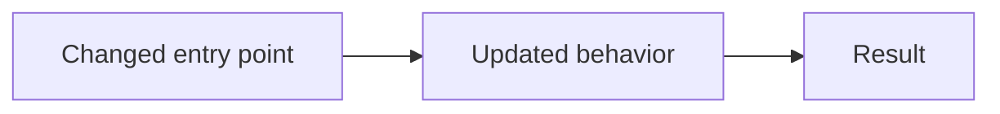

## What changed

<!-- State the resulting behavior and scope in a few plain sentences. -->

## Why it changed

<!-- Explain the problem and why this approach solves it. -->

## Solution design

<!-- Replace this small diagram with the actual path or architecture changed by this PR.
For a documentation/process PR, diagram the process itself. -->

## ADR assessment

Follow the [PR process](https://github.com/F0rge/f0rge/blob/main/docs/agents/pr-process.md).
Assess every ADR below and sort by compliance, with gaps first. Review and
compliance are separate; keep known existing gaps visible outside this PR's scope.

<!-- Order: No, Partial, Not assessed, Approved exception, Yes for PR, Outside PR scope.
Within a status, Existing gap? = Yes, then Not assessed, then No; break ties in canonical index order (P-001–P-064, then C-001–C-002). Replace every placeholder.
An approved exception needs a link to Leo's explicit approval, scope and any conditions. -->

| ADR | Reviewed | Complies? | Existing gap? | Reason / comment |
| --- | --- | --- | --- | --- |
| [P-001 — Canonical ADRs](https://github.com/F0rge/f0rge/blob/main/docs/adr/governance.md#p-001) | No | Not assessed | Not assessed | Complete assessment. |
| [P-002 — Default stack and migrations](https://github.com/F0rge/f0rge/blob/main/docs/adr/governance.md#p-002) | No | Not assessed | Not assessed | Complete assessment. |
| [P-003 — ADR assessment on every PR](https://github.com/F0rge/f0rge/blob/main/docs/adr/governance.md#p-003) | No | Not assessed | Not assessed | Complete assessment. |
| [P-004 — Automated architecture checks](https://github.com/F0rge/f0rge/blob/main/docs/adr/governance.md#p-004) | No | Not assessed | Not assessed | Complete assessment. |
| [P-005 — Independent review](https://github.com/F0rge/f0rge/blob/main/docs/adr/governance.md#p-005) | No | Not assessed | Not assessed | Complete assessment. |
| [P-006 — Leo approves production releases](https://github.com/F0rge/f0rge/blob/main/docs/adr/governance.md#p-006) | No | Not assessed | Not assessed | Complete assessment. |
| [P-007 — Repository agent profiles](https://github.com/F0rge/f0rge/blob/main/docs/adr/governance.md#p-007) | No | Not assessed | Not assessed | Complete assessment. |
| [P-008 — Brief and mockup before substantial work](https://github.com/F0rge/f0rge/blob/main/docs/adr/product.md#p-008) | No | Not assessed | Not assessed | Complete assessment. |
| [P-009 — Design all user states](https://github.com/F0rge/f0rge/blob/main/docs/adr/product.md#p-009) | No | Not assessed | Not assessed | Complete assessment. |
| [P-010 — Holiday explorer pilot](https://github.com/F0rge/f0rge/blob/main/docs/adr/product.md#p-010) | No | Not assessed | Not assessed | Complete assessment. |
| [P-011 — Rust backends](https://github.com/F0rge/f0rge/blob/main/docs/adr/backend.md#p-011) | No | Not assessed | Not assessed | Complete assessment. |
| [P-012 — Actix Web HTTP framework](https://github.com/F0rge/f0rge/blob/main/docs/adr/backend.md#p-012) | No | Not assessed | Not assessed | Complete assessment. |
| [P-013 — Diesel PostgreSQL ORM](https://github.com/F0rge/f0rge/blob/main/docs/adr/backend.md#p-013) | No | Not assessed | Not assessed | Complete assessment. |
| [P-014 — Layered app architecture](https://github.com/F0rge/f0rge/blob/main/docs/adr/backend.md#p-014) | No | Not assessed | Not assessed | Complete assessment. |
| [P-015 — Shared Rust plumbing](https://github.com/F0rge/f0rge/blob/main/docs/adr/backend.md#p-015) | No | Not assessed | Not assessed | Complete assessment. |
| [P-016 — PostgreSQL by default](https://github.com/F0rge/f0rge/blob/main/docs/adr/data.md#p-016) | No | Not assessed | Not assessed | Complete assessment. |
| [P-017 — App-owned data and APIs](https://github.com/F0rge/f0rge/blob/main/docs/adr/data.md#p-017) | No | Not assessed | Not assessed | Complete assessment. |
| [P-018 — Separate app databases on Pi](https://github.com/F0rge/f0rge/blob/main/docs/adr/data.md#p-018) | No | Not assessed | Not assessed | Complete assessment. |
| [P-019 — Separate Railway projects](https://github.com/F0rge/f0rge/blob/main/docs/adr/data.md#p-019) | No | Not assessed | Not assessed | Complete assessment. |
| [P-020 — Controlled release migrations](https://github.com/F0rge/f0rge/blob/main/docs/adr/data.md#p-020) | No | Not assessed | Not assessed | Complete assessment. |
| [P-021 — Rust contracts and generated clients](https://github.com/F0rge/f0rge/blob/main/docs/adr/api.md#p-021) | No | Not assessed | Not assessed | Complete assessment. |
| [P-022 — Shared API errors](https://github.com/F0rge/f0rge/blob/main/docs/adr/api.md#p-022) | No | Not assessed | Not assessed | Complete assessment. |
| [P-023 — Standalone React frontend](https://github.com/F0rge/f0rge/blob/main/docs/adr/frontend.md#p-023) | No | Not assessed | Not assessed | Complete assessment. |
| [P-024 — Strict TypeScript](https://github.com/F0rge/f0rge/blob/main/docs/adr/frontend.md#p-024) | No | Not assessed | Not assessed | Complete assessment. |
| [P-025 — Vite tooling](https://github.com/F0rge/f0rge/blob/main/docs/adr/frontend.md#p-025) | No | Not assessed | Not assessed | Complete assessment. |
| [P-026 — Primer design system](https://github.com/F0rge/f0rge/blob/main/docs/adr/frontend.md#p-026) | No | Not assessed | Not assessed | Complete assessment. |
| [P-027 — Primer tokens and accessible themes](https://github.com/F0rge/f0rge/blob/main/docs/adr/frontend.md#p-027) | No | Not assessed | Not assessed | Complete assessment. |
| [P-028 — Shared UI bricks](https://github.com/F0rge/f0rge/blob/main/docs/adr/frontend.md#p-028) | No | Not assessed | Not assessed | Complete assessment. |
| [P-029 — Storybook catalogue](https://github.com/F0rge/f0rge/blob/main/docs/adr/frontend.md#p-029) | No | Not assessed | Not assessed | Complete assessment. |
| [P-030 — TanStack Query and generated clients](https://github.com/F0rge/f0rge/blob/main/docs/adr/frontend.md#p-030) | No | Not assessed | Not assessed | Complete assessment. |
| [P-031 — TanStack Router](https://github.com/F0rge/f0rge/blob/main/docs/adr/frontend.md#p-031) | No | Not assessed | Not assessed | Complete assessment. |
| [P-032 — TanStack Form and Primer adapters](https://github.com/F0rge/f0rge/blob/main/docs/adr/frontend.md#p-032) | No | Not assessed | Not assessed | Complete assessment. |
| [P-033 — Authoritative backend validation](https://github.com/F0rge/f0rge/blob/main/docs/adr/api.md#p-033) | No | Not assessed | Not assessed | Complete assessment. |
| [P-034 — Accessibility: WCAG 2.2 AA](https://github.com/F0rge/f0rge/blob/main/docs/adr/frontend.md#p-034) | No | Not assessed | Not assessed | Complete assessment. |
| [P-035 — Private and customer auth modes](https://github.com/F0rge/f0rge/blob/main/docs/adr/security.md#p-035) | No | Not assessed | Not assessed | Complete assessment. |
| [P-036 — Verified identity adapters](https://github.com/F0rge/f0rge/blob/main/docs/adr/security.md#p-036) | No | Not assessed | Not assessed | Complete assessment. |
| [P-037 — RBAC and ABAC permissions](https://github.com/F0rge/f0rge/blob/main/docs/adr/security.md#p-037) | No | Not assessed | Not assessed | Complete assessment. |
| [P-038 — Tenant isolation](https://github.com/F0rge/f0rge/blob/main/docs/adr/security.md#p-038) | No | Not assessed | Not assessed | Complete assessment. |
| [P-039 — Task-scoped real-data access](https://github.com/F0rge/f0rge/blob/main/docs/adr/security.md#p-039) | No | Not assessed | Not assessed | Complete assessment. |
| [P-040 — One-command local startup](https://github.com/F0rge/f0rge/blob/main/docs/adr/development.md#p-040) | No | Not assessed | Not assessed | Complete assessment. |
| [P-041 — Full local app and CI testing](https://github.com/F0rge/f0rge/blob/main/docs/adr/development.md#p-041) | No | Not assessed | Not assessed | Complete assessment. |
| [P-042 — Safe external-service testing](https://github.com/F0rge/f0rge/blob/main/docs/adr/development.md#p-042) | No | Not assessed | Not assessed | Complete assessment. |
| [P-043 — Tests use the actual database engine](https://github.com/F0rge/f0rge/blob/main/docs/adr/development.md#p-043) | No | Not assessed | Not assessed | Complete assessment. |
| [P-044 — Reviewed dependency upgrades](https://github.com/F0rge/f0rge/blob/main/docs/adr/development.md#p-044) | No | Not assessed | Not assessed | Complete assessment. |
| [P-045 — Release tags select the host](https://github.com/F0rge/f0rge/blob/main/docs/adr/delivery.md#p-045) | No | Not assessed | Not assessed | Complete assessment. |
| [P-046 — Exact tested release artifacts](https://github.com/F0rge/f0rge/blob/main/docs/adr/delivery.md#p-046) | No | Not assessed | Not assessed | Complete assessment. |
| [P-047 — Approved host migration](https://github.com/F0rge/f0rge/blob/main/docs/adr/delivery.md#p-047) | No | Not assessed | Not assessed | Complete assessment. |
| [P-048 — Managed Pi artifact deployment](https://github.com/F0rge/f0rge/blob/main/docs/adr/delivery.md#p-048) | No | Not assessed | Not assessed | Complete assessment. |
| [P-049 — Protected gateway and origins](https://github.com/F0rge/f0rge/blob/main/docs/adr/delivery.md#p-049) | No | Not assessed | Not assessed | Complete assessment. |
| [P-050 — Standard app domains](https://github.com/F0rge/f0rge/blob/main/docs/adr/delivery.md#p-050) | No | Not assessed | Not assessed | Complete assessment. |
| [P-051 — Health checks and visibility](https://github.com/F0rge/f0rge/blob/main/docs/adr/operations.md#p-051) | No | Not assessed | Not assessed | Complete assessment. |
| [P-052 — Logs and resource limits](https://github.com/F0rge/f0rge/blob/main/docs/adr/operations.md#p-052) | No | Not assessed | Not assessed | Complete assessment. |
| [P-053 — Managed secrets](https://github.com/F0rge/f0rge/blob/main/docs/adr/operations.md#p-053) | No | Not assessed | Not assessed | Complete assessment. |
| [P-054 — Backups and tested recovery](https://github.com/F0rge/f0rge/blob/main/docs/adr/operations.md#p-054) | No | Not assessed | Not assessed | Complete assessment. |
| [P-055 — Rust jobs and Python orchestration](https://github.com/F0rge/f0rge/blob/main/docs/adr/workflows.md#p-055) | No | Not assessed | Not assessed | Complete assessment. |
| [P-056 — Transactional queue or outbox](https://github.com/F0rge/f0rge/blob/main/docs/adr/workflows.md#p-056) | No | Not assessed | Not assessed | Complete assessment. |
| [P-057 — Safe retries and ambiguous outcomes](https://github.com/F0rge/f0rge/blob/main/docs/adr/workflows.md#p-057) | No | Not assessed | Not assessed | Complete assessment. |
| [P-058 — Approval for consequential reruns](https://github.com/F0rge/f0rge/blob/main/docs/adr/workflows.md#p-058) | No | Not assessed | Not assessed | Complete assessment. |
| [P-059 — App-local DAGs and shared orchestration](https://github.com/F0rge/f0rge/blob/main/docs/adr/workflows.md#p-059) | No | Not assessed | Not assessed | Complete assessment. |
| [P-060 — Airflow trust and isolation](https://github.com/F0rge/f0rge/blob/main/docs/adr/workflows.md#p-060) | No | Not assessed | Not assessed | Complete assessment. |
| [P-061 — Workflow concurrency and timeouts](https://github.com/F0rge/f0rge/blob/main/docs/adr/workflows.md#p-061) | No | Not assessed | Not assessed | Complete assessment. |
| [P-062 — Workflow ownership and recovery](https://github.com/F0rge/f0rge/blob/main/docs/adr/workflows.md#p-062) | No | Not assessed | Not assessed | Complete assessment. |
| [P-063 — Small workflow messages and retained data](https://github.com/F0rge/f0rge/blob/main/docs/adr/workflows.md#p-063) | No | Not assessed | Not assessed | Complete assessment. |
| [P-064 — Versioned inputs and reproducible replay](https://github.com/F0rge/f0rge/blob/main/docs/adr/workflows.md#p-064) | No | Not assessed | Not assessed | Complete assessment. |
| [C-001 — Generated Zod forms (conditional)](https://github.com/F0rge/f0rge/blob/main/docs/adr/frontend.md#c-001) | No | Not assessed | Not assessed | Complete assessment. |
| [C-002 — Frontend test tools (conditional)](https://github.com/F0rge/f0rge/blob/main/docs/adr/frontend.md#c-002) | No | Not assessed | Not assessed | Complete assessment. |

## Checks and limitations

<!-- Give exact checks and results, evidence links, independent review, and untested behavior.
For UI/API behavior, include the safe live-server walkthrough and an error path.
State any release limitation; a PR, green checks or a merge does not approve production. -->
