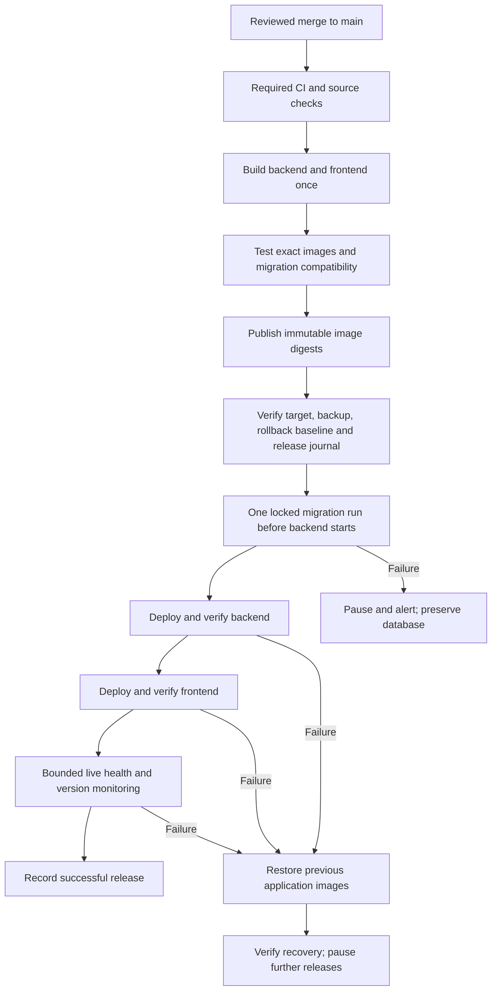

# Firstout continuous deployment

After activation, Firstout releases automatically after a reviewed PR merges to
`main` and its required CI checks pass. This implements the Firstout scope of
[P-006](../../docs/adr/governance.md#p-006); all other apps retain their release
holds. Auto-merge stays disabled. This PR prepares the pipeline; it neither
merges itself nor configures live credentials or deploys production.

## What the pipeline guarantees

- Only the fixed Firstout Railway project, production environment and API /
  frontend services are deployment targets. Other apps and database services
  cannot be selected through workflow inputs.
- The automatic trigger accepts successful `CI` runs from this repository's
  `main` push events. It verifies the exact source SHA's required CI/smoke
  evidence and merged-PR review provenance. PR/fork runs and direct pushes do
  not provide a deployment authorization path.
- Nx selects affected Firstout work, including shared backend dependencies.
  Backend and frontend images are built together from one source commit, tested,
  published and subsequently deployed by immutable digest without rebuilding.
- One Firstout release runs at a time. Durable GitHub issue journals record
  intent before provider mutations, captured previous image identities and
  observed outcomes. Open failed/unfinished journals block later releases.
- Migration policy allows only reviewed compatible revisions with matching
  file hashes. PostgreSQL locking prevents overlapping migration runs; release
  receipts bind the image commit, target schema and policy. Unclassified or
  edited migration files stop deployment.
- Production readiness checks database connectivity and migration completion.
  Provider observations verify the actual running image and settled replica
  set; frontend health checks complement that evidence.
- Database rollback is never automatic. Application recovery retains compatible
  schema additions and new customer transactions. Destructive schema changes
  must be split into later reviewed releases after the rollback window closes.

## Activation prerequisites

Complete these as a separately scoped operations task before the first live
release. Missing prerequisites fail closed; they are not silently treated as a
successful deployment.

1. Configure the dedicated GitHub environment `firstout-production` for `main`
   only, with no per-release required reviewer. Keep all other production
   environments and release holds unchanged. Restrict production credentials
   to this environment and disable alternate Firstout source/image triggers.
2. Supply environment secret `FIRSTOUT_RAILWAY_TOKEN` scoped to the Firstout
   production target. GitHub's built-in token handles registry publication and
   journal records. Never put application/database secrets in build arguments,
   issue journals, images or release artifacts.
3. Verify required source checks and review identity. The pipeline needs an
   approved review tied to the PR's current head from someone other than its
   author with repository write, maintain or admin permission; an agent's prose claiming independent review is not that GitHub
   record. Protect workflow/policy changes through repository review rules. Protect
   `release/firstout/railway/*` tags from update/deletion while allowing the
   pipeline identity to create them.
4. Preserve the existing public build variables `FIRSTOUT_API_URL`,
   `FIRSTOUT_CLERK_PUBLISHABLE_KEY` and
   `FIRSTOUT_TENANT_SUBDOMAINS_ENABLED`. Preserve server-only Clerk, proxy,
   workspace-signing and storage configuration on the existing services.
5. Establish a verified pinned rollback image for both API and frontend before
   activation. The API baseline must expose database-backed `/api/v1/ready` and
   have its completed source/schema migration receipt. Converting any
   Git-source or non-CD-aware API to this pinned baseline is a one-time controlled
   packaging, migration and promotion operation; setting a variable alone does
   not perform it. Configure `FIRSTOUT_BOOTSTRAP_BACKEND_IMAGE` for the initial
   compatibility test only; its digest must match the actually serving backend.
   Subsequent releases derive that baseline from successful release history.
   Mutable Git source and unverified prior images are rejected.
   The first CD-aware baseline therefore includes migration 090 and this
   readiness/receipt implementation. Merely pinning an older 089 image is
   insufficient. The old-089-image compatibility test proves data compatibility,
   not readiness to act as the production CD rollback baseline.
6. Verify Firstout's database migration login/runtime grants and a recent usable
   provider backup. The backup gate checks provider snapshot identity, age and
   expiry; it does not prove restoration works. Retain an independent restore
   rehearsal and a recovery plan before enabling automatic releases.
7. Rehearse successful release, failed migration, bad backend/frontend health,
   interrupted submission and recovery using isolated synthetic resources.
   Confirm no production writes, emails or charges occur in test journeys.

## Pause and recovery

An open issue named `[Firstout CD paused]` from an authorized repository
collaborator is an operator pause. Public outsider issues are not deployment
authority. Each release
also has a `[Firstout CD] <source SHA>` journal. Failure, interrupted mutation
or automatic rollback leaves a blocking record and preserves diagnostic data.
Do not close it to retry an uncertain provider action: inspect the serving
deployment and journal, then use the controller's recovery path and verify the
result. Resume only after the previous outcome is reconciled. Closing an incident
does not authorize redeploying its failed source SHA: the next candidate must
come from a new reviewed commit. A completed successful release may be recognized
as already applied; completed mutations are not replayed blindly.

Recovery restores the previous frontend before the previous backend when those
services were attempted, verifies their digests/health, and keeps further
releases paused. It skips migration commands while restoring older images.
If recovery cannot be verified, the result is a failed recovery requiring an
operator, not a successful rollback. The pipeline never restores a database
backup or repeatedly retries ambiguous mutations.

## Verification boundaries

Tests cover exact-image probes, real PostgreSQL migration/receipt/locking paths,
old-backend compatibility and release/recovery failure cases with external
GitHub/Railway calls isolated. Frontend image probes check public host, health
and asset behavior. They do not establish a complete authenticated Clerk browser
journey; that requires dedicated sandbox identities and remains a visible gap.

Implementation bounds are a 900-second wait per deployment/recovery, six
monitoring samples ten seconds apart, and a provider-backup age limit of 24
hours. The deployment job budget covers both rollout and recovery. These are
initial implementation bounds, not approved platform SLOs.

Local tests and fixture provider responses do not establish live credential
scope, deployed image identity, backup recoverability or successful production
rollback. Runtime monitoring is bounded to the release verification period;
later incidents require ongoing monitoring and operator recovery. Final executed
checks and any unavailable provider rehearsal are recorded in the PR.

## Local verification record

Verified on 15 November 2026 after starting from refreshed main `a161b3aa`
and integrating the concurrent main changes through `6b758a29`:

- Full Firstout backend regression rerun: **950 passed**. The embedded Alembic logger regression and the merge-specific 089
  test assumption were corrected; the complete integrated rerun passed.
- Release/workflow suite: **112 passed**, including **27** controller recovery
  cases; pinned Python 3.11, actionlint and Ruff checks passed.
- Frontend lint/typecheck and **181 tests** passed. Both Linux/AMD64 production
  images built; frontend offline health/host/asset checks passed.
- Final candidate image authenticated HTTP/PostgreSQL journey, anonymous
  readiness/no-store/version checks and migration replay passed. A separately
  built actual pre-CD backend from `6b758a29` read the expanded 090 schema and
  candidate-written customer data. These images use synthetic local fixture
  configuration, not a published production release. The retained manual API image probe also
  passed on PostgreSQL 18 with normal startup and nonowner RLS checks.
- Independent data verification: **18** PostgreSQL cases, plus **3** final
  restricted-runtime/readiness/header cases passed. After main integration,
  policy/upgrade/graph checks (3 cases) and the full 089 merge suite (4 cases)
  passed independently. The runtime can read schema
  metadata but cannot update it.
- Actual local Uvicorn walkthrough: readiness 200 with its receipt; stopping the
  task-owned database yielded readiness 503 while liveness stayed 200; restoring
  the test connection returned readiness to 200. API logs showed no unexpected
  500s.
- Agent generation consistency and **86** regression cases, Nx registration,
  library boundaries and diff whitespace checks passed. Independent security,
  data, backend, delivery, DevOps and quality reviews reported no remaining
  blocking source findings; corrective slices received another review.

No production release, registry publication, provider configuration, secret
installation, live migration or backup restoration was performed. The activation
prerequisites above remain required; local evidence does not establish them.
