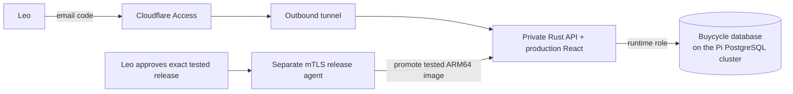
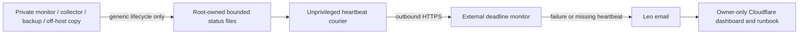

# Buycycle operations

This directory prepares the private Pi migration. It does not change the running
service or authorize a release. [Readiness evidence](../docs/ops-readiness.md)
separates tested source from the provider work that still blocks production.



## Run locally

From the repository root, with Docker, Node, Rust and libpq available:

```sh
python3 apps/buycycle/ops/dev.py
```

Open `http://127.0.0.1:8090`. This builds the production frontend and Rust API,
uses disposable PostgreSQL and a local signed identity fixture, seeds synthetic
listings and disables collection. Ctrl-C stops the app and identity fixture; the
labelled local database is retained. No real Access, feed or Pi data is used.

```sh
npx nx run buycycle-ops:lint
npx nx run buycycle-ops:format-check
npx nx run buycycle-ops:test
python3 apps/buycycle/migration/rehearse_restore.py \
  --evidence /private/tmp/buycycle-restore-rehearsal.json
python3 apps/buycycle/ops/image_rehearsal.py \
  --output /private/tmp/buycycle-arm64-rehearsal
```

The image command builds and probes `linux/arm64`, including real PostgreSQL,
signed identity, denied direct-origin access, production assets, state persistence
and conflicts. Keep its archive and evidence outside Git. `--allow-dirty` is for
exploration; its output cannot pass release verification. A production release
needs the final clean commit's tested archive, successful main CI and protected
immutable release tag, then approval of its published digest and receipt hashes.
Use `--postgres-major 15` to test the selected PostgreSQL 15.19 fixture; the default
remains 17.12. Both fixtures are digest-pinned and the observed version is retained
in evidence. `--image IMAGE --expected-commit SHA` re-tests an existing image
without rebuilding it and still requires its actual source label to match.
Evidence records the separate `harness_commit` and actual checkout dirty state;
a local supplemental compatibility probe cannot replace trusted main CI evidence.

## Production configuration

`compose.yml` has **no app host ports**. A dedicated outbound connector is its
only inbound route; the API independently verifies the Access signature, issuer,
exact audience, expiry and allowed signed owner email. Health endpoints contain
no user data. Collection remains disabled in the proposed production Compose.

Use an app-owned `buycycle` database on the **selected existing Pi application-data cluster**.
`BUYCYCLE_DATABASE_NETWORK` is mandatory. The `bootstrap-cluster` profile is only
for a verified absence of an existing platform cluster; it is never an automatic
fallback. Inventory custom/host-managed PostgreSQL too: the preflight can count
official PostgreSQL Docker images, not prove that no other database process exists.

Select the observed server major explicitly with `postgres_major` (15 or the
retained 17 test target), and set `postgres_admin_role` to the existing verified
local administrative login; the preflight does not assume a `postgres` role or
create one. It performs only fixed catalog reads through that login.
`postgres_inventory` must enumerate every observed PostgreSQL container using
its full ID, image reference/local image ID, exact Compose project/service labels,
major, purpose and classification. Exactly one entry is the selected
`application_data` cluster; known Coolify/Airflow metadata instances must be
recorded explicitly as `coolify_control_plane`/`airflow_metadata`. Missing,
changed, duplicate or additional application-data clusters fail closed. Stopped
instances stay in the inventory with image/configuration binding only, explicitly
without a running-version observation; the preflight never starts them. The
selected application cluster must be running and its SQL server version is read.
Classifications are inventory, **not ADR exceptions**. The receipt includes all
entries and reports `p018_single_cluster_observed` separately; host-wide P-018
compliance remains unverified even when the selected Buycycle database is safe.
Multiple observed control-plane instances remain a visible host-wide legacy gap
against P-018's one-cluster target; classification does not accept that gap.
Do not upgrade, create or consolidate another application's database to satisfy
this check without separately reviewed authorization.

The default synthetic recovery drill retains PostgreSQL 17 on loopback port 5549.
For a selected PostgreSQL 15 server, create a separate task-owned synthetic
`buycycle-migration-pg15` fixture using a reviewed PostgreSQL 15 image, database
`buycycle_rehearsal` and an unused **loopback-only** port, then run (replace 5551
with the actual unused port selected for that fixture):

```sh
python3 apps/buycycle/migration/rehearse_restore.py \
  --postgres-major 15 --container buycycle-migration-pg15 --port 5551 \
  --evidence /private/tmp/buycycle-pg15-restore-rehearsal.json
```

The drill verifies the actual server and dump/restore/query client versions,
reconciles all nine tables and rejects a backup that predates an acknowledged
watch/trade/cost edit. It never reads the deployed database. The Ops regression
also uses a digest-pinned PostgreSQL 15.19 fixture with the existing-admin-name
case, actual schema/grants and a read-only backup role. Its fake age process
proves streaming only; real encryption and offline custody need their own drill.

Install files under root-owned, non-symlink, non-group/world-writable ancestors.
Keep `runtime.env`, provider read tokens, policy and receipt files mode 0600.
Compose binds individual secret files; do not put passwords or tunnel tokens in
the env file, argv, source or app logs. Required secret files are mode 0400/0600:

| File | Host UID | Consumer |
| --- | --- | --- |
| `runtime_database_url` | 10001 | API runtime only |
| `migrator_database_url` | 10001 | Explicit maintenance task only |
| `tunnel_token` | 65532 | Connector only |

Verify these UIDs against the selected immutable images before activation.
PostgreSQL administrator/bootstrap secrets are not mounted into the app. The
runtime cannot create schema or delete retained records; the migrator owns DDL.
`migrate --grant-runtime` applies the canonical grant file after migration and
fails if its role prerequisites are missing. API startup performs no migration.

### Backup connection to an existing Docker-only cluster

The host backup/monitor clients remain restricted to `127.0.0.1:5547`, database
`buycycle` and the read-only `buycycle_backup` role. When the selected existing
cluster has no host port, use the supplied `buycycle-db-proxy.socket` and
`buycycle-db-proxy.service` templates. Substitute only its independently verified
private bridge IPv4 address in the service's destination and `/32` allow rule.
This adds a loopback socket; it does not publish or restart the database or change
another app's service. The proxy has a dynamic unprivileged account, four-connection
limit, no capabilities, no secrets or Docker access, and network access only to
loopback and the selected target address.

Privately copy `database-proxy.example.json` to root-owned mode-0600
`/etc/buycycle/database-proxy.json`, with observed full container/image/network
identities and hashes of the reviewed installed units and proxy executable.
Install the rendered units under `/etc/systemd/system/`, reload systemd and enable
the socket only during the authorized bootstrap. Include
`"database_proxy_policy": "/etc/buycycle/database-proxy.json"` in **both** backup
and monitor configuration. Root production calls cannot omit this policy.

Before a backup/monitor database connection, the read-only guard verifies the
fixed local Docker engine, running selected container, image and Compose labels,
bridge ownership of the target IP, exact installed unit hashes, loaded command
and hardening, and sole loopback listener. It accepts a verified waiting socket
or the exact running proxy process. Changed/replaced containers, IP reuse,
unreviewed drop-ins, stale loaded units, public listeners and unknown unit states
fail closed. It never starts a service or automatically retargets a replacement.
An approved database lifecycle change needs a fresh identity review and policy.
Non-root synthetic tests use the existing explicit UID fixture seam; no production
JSON flag disables the guard.

```sh
python3 /opt/f0rge/apps/buycycle/ops/db_proxy_guard.py \
  --config /etc/buycycle/database-proxy.json
```

Provision PostgreSQL **client-only** tools for the selected major through the
official signed distribution/PGDG packages and age through the signed Debian
repository; review the simulated package transaction first. Do not install a
PostgreSQL server/meta-package, upgrade another app's cluster, or weaken the
localhost restriction to make a backup run. Unit definitions and synthetic
boundary tests do not prove a live proxy, encrypted restore or off-host custody;
those remain required bootstrap evidence.

The configured 768 MiB/1 CPU app/database limits and connector limits are local
test starting points. They are not approved availability, capacity or latency
targets. Logs rotate at 10 MiB × 3; persistent raw observations, imports and
browser journals have no automatic purge.

Full report requests reserve one in-process capacity permit before loading the
database snapshot. Calculation and JSON serialization run off the HTTP worker;
the response retains that permit until EOF or disconnect. Delivery uses copied
chunks of at most 64 KiB, so an outstanding transport chunk cannot retain the
whole encoded report. An independent fixed 120-second safeguard drops both the
encoded allocation and permit even if the transport stops polling. Expiry
terminates an incomplete response as an error; its original content length stays
fixed, preventing an apparent successful empty response. Health, readiness and
status do not wait for this permit. This is an implementation failure bound,
not an approved SLO or a guarantee of spare memory for future dataset growth.
Local slow-reader and full-size browser tests do not prove that Cloudflare
propagates client disconnects; verify that transport during activation.

## Stage the separately approved cutover

1. Verify the actual Pi, Docker engine ID/ARM64 architecture, existing PostgreSQL
   cluster/network, volume custody and all current app/collector/scheduler names.
   Preserve the old volume, DB/WAL/SHM, safety ledger and published files. Do not
   run `compose down -v`, reset the ledger or delete legacy data.
2. Export watches, trades and cost settings from **every** original browser
   device/profile/scheme/host/port, including 8095 and 8096 and LAN/tailnet aliases.
   Keep conflicting exports for explicit review. Follow the exact reconciliation
   procedure in [data migration](../docs/data-migration.md).
3. Configure owner-only Access email OTP and a dedicated tunnel/DNS route using
   [the plan](cloudflare-access-plan.example.json). Its example is inventory and
   intended request shapes, not an executable API payload. There must be exactly
   one explicit owner-email Allow policy, no Bypass policy, no alternate IDP or
   preflight bypass, and a final tunnel 404 route. Copy the created app audience
   and Access team issuer exactly; verify them from provider reads.
4. Fence the **old** collector and every cron/scheduled task. Disable Coolify
   automatic/preview deploys, remove manual deploy webhook secrets and stop the
   old application without deleting volumes. Preserve its configuration as
   recovery evidence. A source build or old writer must not race the new service.
5. Provision distinct managed runtime/migrator roles on the selected cluster.
   From the approved tested image run the explicit maintenance migration, preview,
   import and reconciliation steps. Record every source count/hash and browser
   export; do not enable collection until its durable safety ledger permits it.
6. Establish protected encrypted backups, backup-role grants, off-device custody,
   backup/monitor timers and the required recovery point. Prove an encrypted
   backup restores and reconciles into a separate candidate, including the latest
   acknowledged edit. The local dump drill does not prove production custody,
   encrypted restoration or WAL/PITR. Keep release blocked until these are proved.
7. Prepare the GitHub requester App, least-privilege installation, protected
   release-tag rules and separate mTLS agent. Restrict the agent to loopback or
   the Pi tailnet address. Keep its Docker authority out of the app. It accepts
   only a GitHub run ID and request UUID; the managed helper verifies the approved
   image, successful CI, destination, receipts and single-use journal.
8. Stage the connector and managed runtime configuration. Under the separately
   approved provider setup, start the connector with `--no-deps`; plain
   `compose up tunnel` would follow `depends_on` and start the app prematurely.
   The app must stay stopped until the approved exact-image promotion. Run the read-only
   provider preflight below; unknown API fields, unsafe grants, missing secrets,
   wrong engine/configuration or active old writers refuse a passed receipt.
   Assemble migration/restore evidence with the same exact commit/target and a
   fresh UTC timestamp. Never turn a failed observation into `passed: true`.
9. Publish the **already tested** archive and approve its exact digest and receipt
   hashes. After Leo's release approval, the managed agent pulls and starts that
   image without building source. It checks running image/config identity,
   readiness and absent origin port bindings. Verify the deployed signed-in owner
   journey, denied other identity/direct origin, preserved browser state, logs
   and backup/monitor status. Keep collection activation a separately verified
   fixed-schedule step; do not enable arbitrary manual triggers.

## Read-only provider preflight

Copy [the example policy](release-agent-policy.example.json) privately, replacing
every placeholder with observed values. It combines agent and preflight fields;
production tokens/private identities never belong in the repository. Configure
scoped **read** access for Cloudflare Access applications/policies/organization,
identity providers, tunnel configuration and DNS. No Coolify API token or sensitive
read grant is used. Pin its actual local control-plane full container ID, image
reference/local image ID and Compose project/service in `coolify_control_plane`.
The root-managed preflight verifies that running container against the fixed local
Docker inventory, then executes one constant, selected-Buycycle metadata query at
`/var/www/html`. It returns only auto/preview booleans, four webhook-presence bits,
bounded scheduled-task IDs/enabled booleans and provider status. SQL computes
webhook presence without returning plaintext or encrypted webhook values.

The projection's version, exact fields and boolean types must match. Missing
fields, changed control-plane identity, active webhooks/schedules or contradictory
provider/container stop state fail closed. It never fabricates empty secrets from
redacted API fields. The observation is a privileged local read, not a new remote
administration or deployment endpoint; retain its independent source review and
live metadata-probe evidence. See [Cloudflare's app API](https://developers.cloudflare.com/api/resources/zero_trust/subresources/access/subresources/applications/methods/get/)
and [Coolify's sensitive-response permissions](https://coolify.io/docs/api/permissions).

Legacy automation credentials remain a separate containment gate. Repository-level
Coolify secret names still existed in the 15 November 2026 read-only inventory;
current retired deployment workflows were inert and no active/queued/waiting runs
were observed. That does not establish provider-token retirement or prove an
exploit. Disabling builds/webhooks does not revoke an API token with deployment
authority. Retiring a shared repository credential or changing other apps' provider
tokens needs its reviewed scope and authorization; this source change reads no
token values and revokes nothing.

Access must return exactly the pinned OTP provider in its nonempty `allowed_idps`.
The auxiliary `use_all_idps` field is optional; if returned it must be exactly
false. An explicit application `allow_authenticate_via_warp: false` overrides
the organization setting. When the application omits that field, the preflight
requires an observed organization value of exactly false. Missing, null, unknown
or enabled effective WARP authentication fails closed; omission never means
disabled. These rules follow the [application override](https://developers.cloudflare.com/api/resources/zero_trust/subresources/access/subresources/applications/methods/get/)
and [organization inheritance](https://developers.cloudflare.com/api/resources/zero_trust/subresources/organizations/)
contracts while retaining the separate preflight-bypass and owner-policy checks.

Run on the Pi from the installed, protected checkout, writing a new protected
receipt filename (the command never replaces an existing receipt):

```sh
python3 /opt/f0rge/apps/buycycle/ops/preflight.py \
  --config /etc/buycycle-release/policy.json \
  --output /var/lib/buycycle-release/receipts/provider.json
```

It issues only Cloudflare HTTPS GET requests and fixed local Docker inspection/SELECT
commands. It never stops services, changes policies, provisions a database or
reads application rows. Its receipt records the exact commit, Pi engine ID,
Compose/env hashes and observed safety gates, without credentials or owner email.
The release helper independently requires fresh receipts (default one hour),
their approved byte hashes and the same target/configuration. A receipt is a
point-in-time observation, not a guarantee against later provider changes.

## Recovery

Before new PostgreSQL writes, the fenced legacy service is a retained recovery
candidate after reconciling its source snapshot. After **any** new write, Turso is
stale: roll back the application image while retaining authoritative PostgreSQL,
or restore/reconcile a PostgreSQL candidate forward. Never automatically restart
Turso after new writes. A stale dump must not replace an acknowledged edit.
Actual backup destination/custody, restoration and any required WAL/PITR remain
production release gates; this PR makes no zero-data-loss promise.

## Backup, daily collection and monitoring sources

The supplied systemd units are **not installed or enabled** by this PR. The
collector timer targets 06:15 Europe/Luxembourg once daily, with no missed-run
replay. The backup timer proposes 05:30 Luxembourg; the monitor proposes every
15 minutes. Review backup/recovery targets and measure resource/freshness
thresholds before enabling them. A timer definition does not prove it ran.

`backup.py` consumes root-owned mode-0600 `/etc/buycycle/backup.json`: exact
loopback PostgreSQL endpoint/port, database `buycycle`, role `buycycle_backup`,
scoped `pgpassfile`, protected `destination`, public age `recipients_file`, exact
`source_commit`, `timeout_seconds`, explicit `postgres_major` and canonical
`psql`/`pg_dump`/`pg_restore`/`age` executables. The observed server and all three
PostgreSQL clients must match that reviewed major. The ciphertext manifest
retains their version evidence. Use PostgreSQL 15 tools for an observed 15
cluster; do not upgrade an existing database merely to fit the test baseline.
The backup role needs SELECT on all nine tables, without DML/schema authority.
Plaintext is streamed into age; complete backups publish atomically as protected
`database.dump.age` plus a byte-count/hash/time manifest. No retention deletion
runs. The age private decryption identity belongs in separate recovery custody.

`collect.py` consumes `/etc/buycycle/collector.json`: managed Compose/env paths,
pinned image/source commit, fixed Docker executable, timeout, protected
`activation_file` and the release agent's `active_release_receipt`. Before first
release there is no active receipt and collection stays held. Match the receipt
path to `journal_dir/active.json` in the agent policy. Activation assertions must
come from the separately reviewed writer-fence and migration evidence; writing
`enabled: true` is not evidence that the old writer stopped or the budget imported.
Require protected provider/migration receipts and their exact byte hashes in both
activation and the verified active release. Their commit/target and observed
provider engine/Compose/env must match that release. Promotion checks freshness;
the daily collector reuses that approved evidence only while the exact active
release remains unchanged. Missing or mismatched evidence keeps collection held.

`monitor.py` consumes `/etc/buycycle/monitor.json`: the same pinned app/Compose
identity, read-only backup-role connection/`psql`, protected backup directory and
explicit measured backup/collection freshness, memory and disk thresholds. It
checks actual readiness, runtime identity/resources, successful daily collection
and newest ciphertext integrity/freshness. It emits actionable journal failures;
operator notification delivery and off-device copies require separate verification.

After the authorized installation, inspect actual state without triggering a job:

```sh
systemctl is-enabled buycycle-backup.timer buycycle-collect.timer buycycle-monitor.timer
systemctl is-active buycycle-backup.timer buycycle-collect.timer buycycle-monitor.timer
systemctl list-timers buycycle-backup.timer buycycle-collect.timer buycycle-monitor.timer
journalctl -u buycycle-backup.service -u buycycle-monitor.service --since today
```

Retain successful encrypted-restore/reconciliation evidence and observed timer
runs. Backup freshness, timer enablement and ciphertext hashes each prove a
different part of recovery; none alone proves a recoverable, current backup.

## Owner notifications and off-host heartbeat

The proposed free external monitor is [Healthchecks.io Hobbyist](https://healthchecks.io/pricing/):
currently $0/month, 20 checks and a rolling 100 ping records per check. This is
operational telemetry, not the backup archive. It can detect missing outbound
pings when the whole Pi or its network is unavailable. No public Buycycle health
route, Cloudflare service-token bypass or inbound monitoring port is added.
Account creation, email sharing and actual notification sends are separate
activation steps; source tests never contact the hosted service.



`job-status.py` runs the fixed command from each reviewed systemd unit exactly
once and records start/success/failure under `/run/buycycle-alerts`. It preserves
the original exit code, including a failed collector, even when status recording
fails. A killed job leaves an unfinished start; it never fabricates success or
reruns collection. Files contain only schema, job, random run ID, phase and time;
no listing data, logs, watchlists or keys. Missing runtime directories do not
prevent the original jobs from running. Remote missing-ping detection remains
necessary in that case.

`buycycle-heartbeat.service` is a separate unprivileged courier. The existing
collector/backup/monitor network restrictions remain intact. Create a dedicated
system user/group `buycycle-heartbeat` with no login, Docker group or app grants.
Install `buycycle-heartbeat.tmpfiles.conf` as
`/etc/tmpfiles.d/buycycle-heartbeat.conf` and create its runtime directory before
enabling the reviewed units: root owns it, the courier group can only read.
Keep `/opt/f0rge` code root-owned and read-only to the courier. Its only writable
durable state is `/var/lib/buycycle-heartbeat` (0700).

Install the reviewed `heartbeat.example.json` as root:0600
`/etc/buycycle/heartbeat.json`. Store four **different individual check URLs** in
root:0600 `/etc/buycycle/heartbeat-credentials/{monitor,collector,backup,offhost}`
under a root:0700 directory. The URLs must be exactly the documented individual
UUID form at `https://hc-ping.com/`; never use a project key. systemd
`LoadCredential` passes private copies to the courier. No secret goes in argv,
environment variables, journals, receipts or git. See the provider's
[secret URL and deadline semantics](https://healthchecks.io/docs/).

The courier makes direct validated TLS requests, ignores proxy environment
settings, sends an empty body, refuses redirects and bounds transport retries.
Provider acknowledgement is required before durable deduplication. It sends each
new lifecycle event once; it does not repeatedly refresh an old success. Stale,
overdue, invalid, missing or replayed status becomes failure. Restoring an old
status file or reversing the clock cannot claim recovery. A lost response or
crash before recording acknowledgement can repeat the same idempotent signal;
this is not an exactly-once notification guarantee. A new successful job event
is required for recovery.

Configure Leo as owner and email recipient; enable hourly reminders for checks
that remain down. Use only generic job names/error codes and this private runbook
or the authenticated dashboard link in provider descriptions. The hosted service
receives email, source IP, timing and operational status, as described by its
[privacy policy](https://healthchecks.io/privacy/). Do not attach logs. Proposed
initial deadlines below must match installed timers and measured runtimes before
activation; they are not repository-wide SLOs:

| Check | Schedule | Grace / maximum runtime | Local status age bound |
| --- | --- | --- | --- |
| monitor | Every 15 minutes | 10 minutes grace; 5-minute job maximum | 20 minutes |
| collector | 06:15 Europe/Luxembourg daily | 5 hours 15 minutes grace; 5-hour job maximum | 26 hours |
| backup | 05:30 Europe/Luxembourg daily | 2 hours 15 minutes grace; 2-hour job maximum | 26 hours |
| offhost | 07:45 Europe/Luxembourg daily | 2 hours 15 minutes grace; 2-hour job maximum | 26 hours |

The courier runs once per minute. Remote deadlines must remain enabled even
when its local unit fails. Keep checks paused until the relevant producers and
owner routing are ready; unpause them as an explicit activation step. Do not
seed success manually to hide missing production evidence. Verify a dedicated
synthetic failure, reminder, missing heartbeat and recovery, and have Leo confirm
receipt. No production job needs to be stopped or scraped for this test.
**P-062 remains partial until Chief-of-Staff escalation is configured and tested**;
direct owner emails alone do not satisfy that escalation requirement.

## Separate encrypted off-host copy

The existing all-app `/usr/local/sbin/pi-backup.sh` is not sourced, executed or
changed by these additions. Its inventory does not include `/var/backups/buycycle`.
`offhost.py` and its own timer copy only the selected complete, verified encrypted
Buycycle snapshot. The intended reuse is the existing approved SFTP repository
and password custody, through a new protected repository file and strictly
scoped SSH configuration; actual repository and SSH identity must be verified
during the authorized provider setup. No repository is initialized by this code.

Review `offhost.example.json` and `offhost-ssh.example.conf`. All configuration,
password, SSH key and known-host files must be root:0600 under safe directories.
The repository file contains `sftp:buycycle-backup:/<approved-absolute-path>`;
its real contents stay private. The SSH alias is fixed, with an independently
verified known-host entry, exact identity, batch-only authentication and strict
host checking. Includes, proxy/local commands, alternative identities and unsafe
repository syntax are rejected. Do not obtain host trust using an unverified
key scan. The configured server must actually be off the Pi. Existing shared
repository credentials are still broad repository credentials: this source does
not claim per-app remote ACLs or protection from a compromised root host.

The managed unit uses the installed `/usr/bin/restic` with a sanitized environment,
repository/password **file paths** and fixed SSH option. Output, ciphertext size
and total runtime are bounded; errors never print credentials or remote details.
After backup it verifies the exact returned snapshot ID, source path, host and
per-run tags. It reads back the byte-exact manifest and encrypted dump from that
snapshot, checks dump size/hash, then writes root:0600
`/var/lib/buycycle-offhost/latest.json`. Restored bytes go to a fresh private
temporary directory with fixed filenames, not archive-supplied paths; the code
does not extract a tree or follow restored symlinks. Temporary readback is removed
on completion or failure. The original encrypted backup and previous receipt are
preserved on failure, and the job wrapper reports failure to the courier.

There is no remote prune, snapshot deletion, unlock, retention change or automatic
retry. An ambiguous failed attempt may have created a harmless additional snapshot;
inspect it before manually rerunning. The new timer is independent of the existing
all-app backup and may fail safely on repository locking; it must never break that
lock automatically. Proposed size/resource bounds and timing require actual
target verification. An off-host ciphertext readback proves transfer integrity,
not decryption or PostgreSQL recovery: maintain separately tested off-device
age/restic/SSH recovery custody and a database restore/reconciliation drill.
