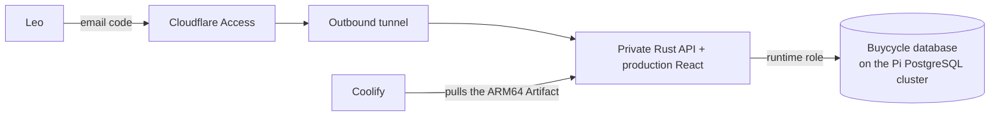

# Buycycle operations

This directory prepares the private Pi migration. It does not change the running
service, and the new app has no deploy block, so the pipeline does not release it. [Readiness evidence](../docs/ops-readiness.md)
separates tested source from the provider work that still blocks production.



## Run locally

From the repository root, with Docker, Node, Rust and libpq available:

```sh
python3 apps/buycycle/ops/dev.py
```

Open `http://127.0.0.1:8090`. This builds the production frontend and Rust API,
uses disposable PostgreSQL and a local signed identity fixture, seeds synthetic
listings and disables collection. Ctrl-C stops the app and identity fixture; the
labelled local database is retained. No real Access, feed or Pi data is used.

```sh
npx nx run buycycle-ops:lint
npx nx run buycycle-ops:format-check
npx nx run buycycle-ops:test
python3 apps/buycycle/migration/rehearse_restore.py \
  --evidence /private/tmp/buycycle-restore-rehearsal.json
python3 apps/buycycle/ops/image_rehearsal.py \
  --output /private/tmp/buycycle-arm64-rehearsal
```

The image command builds and probes `linux/arm64`, including real PostgreSQL,
signed identity, denied direct-origin access, production assets, state persistence
and conflicts. Keep its archive and evidence outside Git. `--allow-dirty` is for
exploration. After the approved cutover the app is released like every other
App: a deploy block, then [the pipeline](../../../.github/deploy/README.md).

## Production configuration

`compose.yml` has **no app host ports**. A dedicated outbound connector is its
only inbound route; the API independently verifies the Access signature, issuer,
exact audience, expiry and allowed signed owner email. Health endpoints contain
no user data. Collection remains disabled in the proposed production Compose.

Use an app-owned `buycycle` database on the **one existing Pi PostgreSQL cluster**.
`BUYCYCLE_DATABASE_NETWORK` is mandatory. The `bootstrap-cluster` profile is only
for a verified absence of an existing platform cluster; it is never an automatic
fallback. Inventory custom/host-managed PostgreSQL too: the preflight can count
official PostgreSQL Docker images, not prove that no other database process exists.

Install files under root-owned, non-symlink, non-group/world-writable ancestors.
Keep `runtime.env`, provider read tokens, policy and receipt files mode 0600.
Compose binds individual secret files; do not put passwords or tunnel tokens in
the env file, argv, source or app logs. Required secret files are mode 0400/0600:

| File | Host UID | Consumer |
| --- | --- | --- |
| `runtime_database_url` | 10001 | API runtime only |
| `migrator_database_url` | 10001 | Explicit maintenance task only |
| `tunnel_token` | 65532 | Connector only |

Verify these UIDs against the selected immutable images before activation.
PostgreSQL administrator/bootstrap secrets are not mounted into the app. The
runtime cannot create schema or delete retained records; the migrator owns DDL.
`migrate --grant-runtime` applies the canonical grant file after migration and
fails if its role prerequisites are missing. API startup performs no migration.

The configured 768 MiB/1 CPU app/database limits and connector limits are local
test starting points. They are not approved availability, capacity or latency
targets. Logs rotate at 10 MiB × 3; persistent raw observations, imports and
browser journals have no automatic purge.

## Stage the separately approved cutover

1. Verify the actual Pi, Docker engine ID/ARM64 architecture, existing PostgreSQL
   cluster/network, volume custody and all current app/collector/scheduler names.
   Preserve the old volume, DB/WAL/SHM, safety ledger and published files. Do not
   run `compose down -v`, reset the ledger or delete legacy data.
2. Export watches, trades and cost settings from **every** original browser
   device/profile/scheme/host/port, including 8095 and 8096 and LAN/tailnet aliases.
   Keep conflicting exports for explicit review. Follow the exact reconciliation
   procedure in [data migration](../docs/data-migration.md).
3. Configure owner-only Access email OTP and a dedicated tunnel/DNS route using
   [the plan](cloudflare-access-plan.example.json). Its example is inventory and
   intended request shapes, not an executable API payload. There must be exactly
   one explicit owner-email Allow policy, no Bypass policy, no alternate IDP or
   preflight bypass, and a final tunnel 404 route. Copy the created app audience
   and Access team issuer exactly; verify them from provider reads.
4. Fence the **old** collector and every cron/scheduled task. Disable Coolify
   automatic/preview deploys, remove manual deploy webhook secrets and stop the
   old application without deleting volumes. Preserve its configuration as
   recovery evidence. A source build or old writer must not race the new service.
5. Provision distinct managed runtime/migrator roles on the selected cluster.
   From the approved tested image run the explicit maintenance migration, preview,
   import and reconciliation steps. Record every source count/hash and browser
   export; do not enable collection until its durable safety ledger permits it.
6. Establish protected encrypted backups, backup-role grants, off-device custody,
   backup/monitor timers and the required recovery point. Prove an encrypted
   backup restores and reconciles into a separate candidate, including the latest
   acknowledged edit. The local dump drill does not prove production custody,
   encrypted restoration or WAL/PITR. Keep release blocked until these are proved.
7. Stage the connector and managed runtime configuration. Under the separately
   approved provider setup, start the connector with `--no-deps`; plain
   `compose up tunnel` would follow `depends_on` and start the app prematurely.
   The app must stay stopped until the approved first Release. Run the read-only
   provider preflight below; unknown API fields, unsafe grants, missing secrets,
   wrong engine/configuration or active old writers refuse a passed receipt.
   Assemble migration/restore evidence with the same exact commit/target and a
   fresh UTC timestamp. Never turn a failed observation into `passed: true`.
8. After Leo approves the cutover, add the deploy blocks and do the first Release
   by hand (`gh workflow run cd.yml -f app=buycycle -f commit=<sha>`). Coolify pulls
   and starts the Artifact without building source. Verify the deployed signed-in owner
   journey, denied other identity/direct origin, preserved browser state, logs
   and backup/monitor status. Keep collection activation a separately verified
   fixed-schedule step; do not enable arbitrary manual triggers.

## Read-only provider preflight

Write the policy file privately with observed values; its fields are the keys
`preflight.py` reads. Production tokens/private identities never belong in the
repository. Configure
scoped **read** access for Access applications/policies, identity providers, tunnel
configuration, DNS, and the selected Coolify app/schedules. No write token is
needed. The Coolify API must return the documented auto/preview-deploy settings;
an incomplete response fails closed. See [Cloudflare's app API](https://developers.cloudflare.com/api/resources/zero_trust/subresources/access/subresources/applications/methods/get/)
and [Coolify's application schema](https://coolify.io/docs/api/endpoints/applications/get-application-by-uuid).

Run on the Pi from the installed, protected checkout, writing a new protected
receipt filename (the command never replaces an existing receipt):

```sh
python3 /opt/f0rge/apps/buycycle/ops/preflight.py \
  --config /etc/buycycle-release/policy.json \
  --output /var/lib/buycycle-release/receipts/provider.json
```

It issues only HTTPS GET requests and fixed local Docker inspection/SELECT
commands. It never stops services, changes policies, provisions a database or
reads application rows. Its receipt records the exact commit, Pi engine ID,
Compose/env hashes and observed safety gates, without credentials or owner email.
A receipt is a point-in-time observation, not a guarantee against later provider
changes.

## Recovery

Before new PostgreSQL writes, the fenced legacy service is a retained recovery
candidate after reconciling its source snapshot. After **any** new write, Turso is
stale: roll back the application image while retaining authoritative PostgreSQL,
or restore/reconcile a PostgreSQL candidate forward. Never automatically restart
Turso after new writes. A stale dump must not replace an acknowledged edit.
Actual backup destination/custody, restoration and any required WAL/PITR remain
production release gates; this PR makes no zero-data-loss promise.

## Backup, daily collection and monitoring sources

The supplied systemd units are **not installed or enabled** by this PR. The
collector timer targets 06:15 Europe/Luxembourg once daily, with no missed-run
replay. The backup timer proposes 05:30 Luxembourg; the monitor proposes every
15 minutes. Review backup/recovery targets and measure resource/freshness
thresholds before enabling them. A timer definition does not prove it ran.

`backup.py` consumes root-owned mode-0600 `/etc/buycycle/backup.json`: exact
loopback PostgreSQL endpoint/port, database `buycycle`, role `buycycle_backup`,
scoped `pgpassfile`, protected `destination`, public age `recipients_file`, exact
`source_commit`, `timeout_seconds` and canonical `pg_dump`/`age` executables.
The backup role needs SELECT on all nine tables, without DML/schema authority.
Plaintext is streamed into age; complete backups publish atomically as protected
`database.dump.age` plus a byte-count/hash/time manifest. No retention deletion
runs. The age private decryption identity belongs in separate recovery custody.

`collect.py` consumes `/etc/buycycle/collector.json`: managed Compose/env paths,
pinned image/source commit, fixed Docker executable, timeout, protected
`activation_file` and an `active_release_receipt`. Nothing writes that receipt
yet, so collection stays held until the cutover defines its writer. Activation assertions must
come from the separately reviewed writer-fence and migration evidence; writing
`enabled: true` is not evidence that the old writer stopped or the budget imported.
Require protected provider/migration receipts and their exact byte hashes in both
activation and the verified active release. Their commit/target and observed
provider engine/Compose/env must match that release. Promotion checks freshness;
the daily collector reuses that approved evidence only while the exact active
release remains unchanged. Missing or mismatched evidence keeps collection held.

`monitor.py` consumes `/etc/buycycle/monitor.json`: the same pinned app/Compose
identity, read-only backup-role connection/`psql`, protected backup directory and
explicit measured backup/collection freshness, memory and disk thresholds. It
checks actual readiness, runtime identity/resources, successful daily collection
and newest ciphertext integrity/freshness. It emits actionable journal failures;
operator notification delivery and off-device copies require separate verification.

After the authorized installation, inspect actual state without triggering a job:

```sh
systemctl is-enabled buycycle-backup.timer buycycle-collect.timer buycycle-monitor.timer
systemctl is-active buycycle-backup.timer buycycle-collect.timer buycycle-monitor.timer
systemctl list-timers buycycle-backup.timer buycycle-collect.timer buycycle-monitor.timer
journalctl -u buycycle-backup.service -u buycycle-monitor.service --since today
```

Retain successful encrypted-restore/reconciliation evidence and observed timer
runs. Backup freshness, timer enablement and ciphertext hashes each prove a
different part of recovery; none alone proves a recoverable, current backup.
