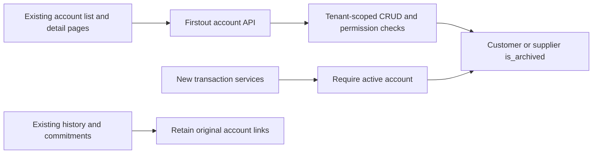

# Customer and supplier archives

Customers and suppliers have **Active** and **Archived** tabs on their existing
list pages. This implements design A. There is no review queue, review status,
review note or “keep archived” workflow.

Archiving changes an account’s availability for new business. It preserves the
account, contacts, terms, balances and available history. This feature does not
delete records, clean an export, import data or automatically archive dormant
accounts.

## User behavior

- `/customers` and `/suppliers` open the active list. `?archived=true` opens the
  archived list directly. Each tab shows its organisation-wide count; search and
  existing filters apply to the selected list.
- An archived account remains accessible at its existing detail URL. Its badge
  and notice identify its state, and the back link returns to Archived.
- Authorised staff can archive or restore from the detail page after confirming
  a dialog. Pending requests disable submission; failures remain visible in the
  dialog and can be retried. Cancel leaves the account unchanged.
- Restoring returns the same account to Active. It does not create a duplicate,
  import older documents, create payments or move stock.
- New-transaction pickers return active accounts. Customer duplicate detection
  still finds archived matches and links to the existing account for restoration.
- Archived customer profiles are read-only in the page. Available contact and
  history sections remain visible. Repeating-invoice lists retain archived
  customer names, mark them as archived and withhold **Run now** until restoration.

## Data and API design

All paths below are under `/api/v1`. Counts are not search-filtered.

| Request | Behavior |
| --- | --- |
| `GET /customers` or `/suppliers` | Active accounts; `archived` defaults to `false`. |
| `GET /customers?archived=true` or `/suppliers?archived=true` | Archived accounts only. |
| `GET /customers/archive-counts` or `/suppliers/archive-counts` | `{ "active": number, "archived": number }` for the current organisation. |
| `GET /customers/{id}` or `/suppliers/{id}` | Detail remains readable in either state. |
| `PATCH /customers/{id}/archive` or `/suppliers/{id}/archive` | Body `{ "is_archived": true }` archives; `false` restores. Repeating the desired state is idempotent. |

Authenticated staff can read both states. Customer archive mutations use the
existing `sales.customers` permission; supplier archive mutations use
`catalogue.mutate`.
Unauthenticated requests return `401`, unauthorised mutations return `403`, and
another organisation’s account returns `404` without changing its state or
including it in counts.

Backend guards reject new customer transactions and portal enrolment/order
creation, and new supplier transactions or catalogue assignments, while the
account is archived. Existing references remain usable for historical reads,
payments against existing invoices, and fulfilment of existing commitments.
Specifically, accepting an existing quote, processing an already-paid storefront
handoff, resolving a SKU on an existing PO, or recording an invoice for that
verified PO does not require recreating or restoring the account. These are
scoped continuations of existing business, not an unrestricted creation bypass.

## Migration and release boundary

Migration `084_party_archives`, following `083_portal_clerk_identity`, adds a
non-null `is_archived` boolean with server default `false` and a
`(team_id, is_archived)` index to each account table. Existing accounts start
active. The migration does not select accounts for archival or alter their
financial and contact rows.

For a separately approved release, verify the Firstout target and recovery
evidence, apply migration 084 as a controlled step, then release the matching
backend and frontend. Do not deploy application code that expects these columns
before the migration. Follow the repository’s
[release hold and remaining requirements](../../../.github/deploy/README.md);
this document and the checks below grant no merge or production-release approval.

An application rollback can retain the additive columns and indexes. Older code
may ignore archive restrictions, so verify behavior before resuming writes.
Before a database downgrade, back up/export the account IDs, tenant IDs and
archive flags: `downgrade()` removes the columns and their state, while retaining
the account rows. Re-upgrading defaults all accounts to active unless their
saved flags are explicitly restored through an authorised recovery process.

## Verification evidence

The implementation was checked locally with synthetic records and PostgreSQL 16.
No production account, imported customer data or real customer contact details
were used. The coordinator performed the live walkthrough; independent
frontend, backend and security source reviews were completed and their reported
issues were resolved.

| Check | Observed result |
| --- | --- |
| Archive API and migration tests | 29 new tests plus 82 affected backend tests passed: 111 total. PostgreSQL 16 scratch database. |
| Frontend tests | `npm run test` in `apps/firstout/frontend`: 145 tests across 26 files passed. |
| TypeScript | Regular strict TypeScript compiler passed. The normal script’s native compiler alias was unavailable in the local checkout. |
| Next.js production build | Passed independently of the browser fixture. |
| Lint and formatting | Full frontend `npm run lint` passed with zero errors and four existing image warnings in bills/read, catalogue/new, proformas/read and app-shell. Pinned Ruff 0.16.1 `check .` and `format --check .` passed; formatting covered 570 files. |
| Repository checks | Nx project registration, shared-library boundaries and `git diff --check` passed. |

The browser walkthrough used the actual Carbon page components and existing
AuthProvider in an ephemeral built Vite fixture with Next navigation and
staff-session adapters. It connected
to the real FastAPI/SQLAlchemy/PostgreSQL implementation through a signed
synthetic Clerk/JWKS boundary. The fixture and adapters are not committed and do
not add an authentication backdoor to the app.

Eleven live check groups passed on desktop (1440 px) and mobile (390 px), covering:

- Active/Archived lists, counts, search and archived detail/back links.
- Archive and restore persisting after reload, and modal cancellation.
- A failed restore (`503`) remaining retryable, and list-load failure/retry.
- Read-only UI behavior and an API mutation returning `403`.
- Delayed customer A responses not replacing customer B after navigation;
  archive confirmation targeted B.
- No browser errors during the recorded flows.

Screenshots and the walkthrough’s detailed evidence are retained as local task
artifacts outside Git. The run is not a full real-Clerk/Next.js end-to-end check,
a production RLS/runtime-grant audit, a complete screen-reader assessment or a
WCAG certification. CI remains pending separately. Firstout production and its
current data were untouched.
