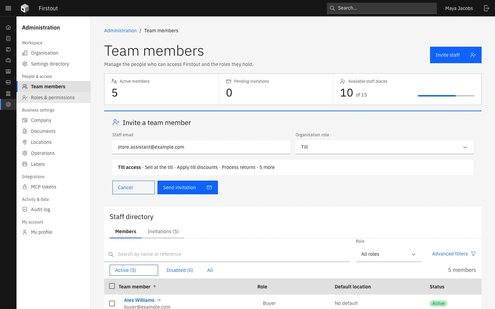
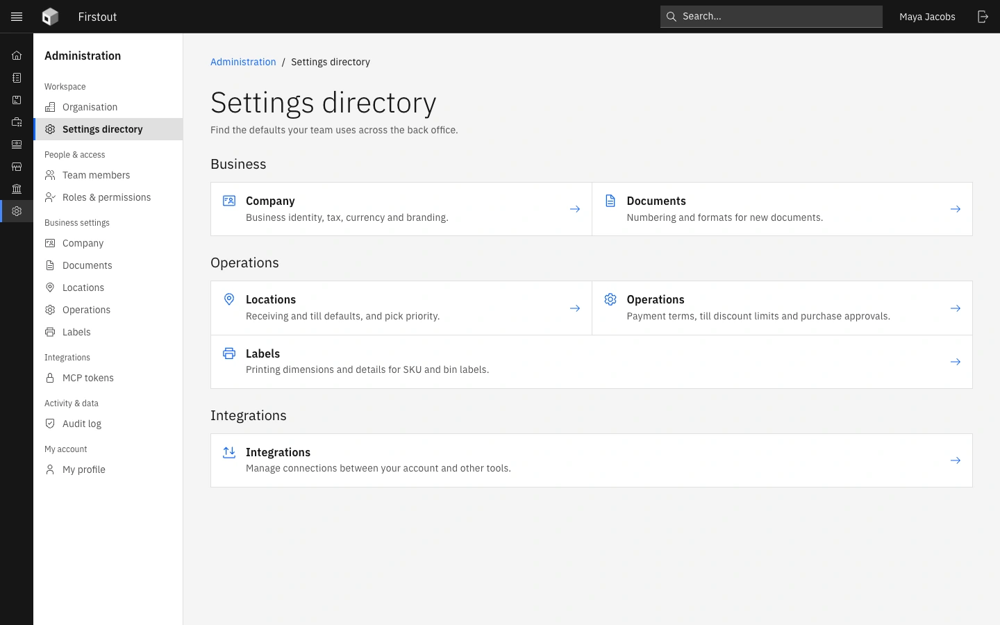
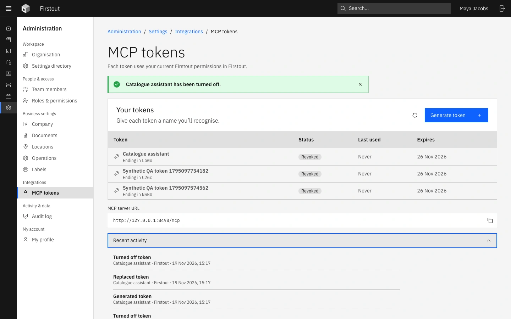
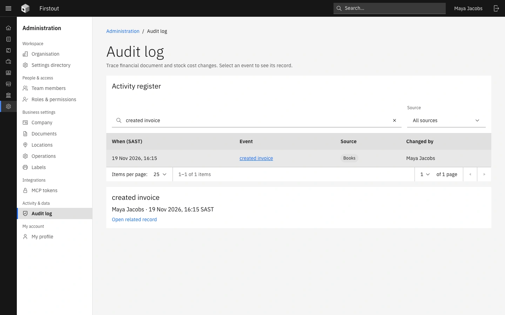

# Firstout Administration

The Administration directory groups team access, business settings, integrations, audit and personal preferences. Search in the header includes the Administration pages available to the signed-in staff member.

## Team access

Open **Team members → Invite staff**. Enter an email address and select a role to see the permissions it grants. Sending adds the person to **Invitations**, where a manager can check the status or revoke a pending invitation. Staff places reflect the organisation's Clerk membership limit and pending invitations. Disabling access in Firstout can leave a Clerk membership in place.

## Settings

The directory links directly to Company, Documents, Locations, Operations and Labels. Each editor displays its own save and discard controls. Roles open in a dialog so the directory stays in view.

## Personal MCP access

Open **Integrations → MCP tokens**. Generate a named token for 7, 30 or 90 days. Copy the one-time secret and the displayed server URL into a client that supports Streamable HTTP with a bearer token. Replacing a token invalidates its previous secret. Revoking it stops access. The credential belongs to one staff member in one organisation.

The catalogue search tool reads active SKUs. Unit costs require the staff member's current cost-viewing permission. The API checks active staff membership in Firstout and Clerk. The backend environment example describes the shared endpoint and signing key.

## Walkthrough evidence

The screenshots show the Next.js interface connected to the local Firstout API and PostgreSQL with synthetic records. Clerk sign-in and invitation delivery used a local provider fixture. The walkthrough exercised invitation submission and revocation, staff access changes, custom roles, settings saves and reloads, profile preferences, token rotation and revocation, and opening an invoice from audit history.

[Team directory on a phone](mobile.webp)
