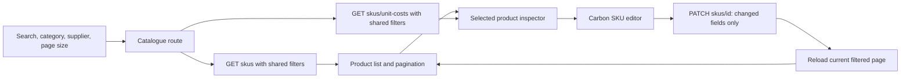
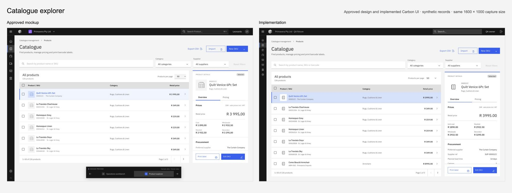
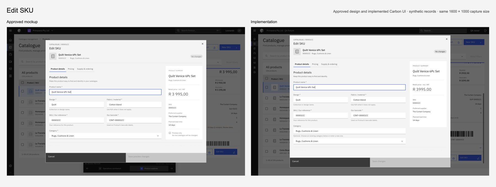

# Catalogue explorer

The catalogue uses the approved split-view design: a searchable product list beside a persistent product inspector. Category and preferred-supplier filters apply before server pagination. The default page contains 50 products; staff can choose 100. The list scrolls independently, keeping pagination below it. The existing full SKU page remains reachable.

The inspector groups VAT-inclusive selling prices, permission-controlled unit cost, procurement fields and our barcode. Planned lead time stays separate from observed receipt history. Product results render independently of the cost request; costs have their own loading, failure and retry states.

Staff with `catalogue.mutate` can edit the selected SKU in a Carbon modal with Product details, Pricing, and Supply & ordering tabs. It sends only changed fields to the existing PATCH endpoint, preserves unset values, leaves cost read-only, reveals invalid fields on their tab, retains a failed-save draft and confirms unsaved discards. The API remains authoritative for permissions, uniqueness and VAT calculations.

## Visual comparison

The left side is the approved mockup; the right side is the actual implementation rendered with synthetic boundary fixtures. Catalogue and editor captures are 1600 × 1000. The comparison images place those unchanged captures in an 1800 × 680 comparison page.

Full captures: [implemented catalogue](catalogue-explorer/implemented-catalogue.jpg), [implemented editor](catalogue-explorer/implemented-editor.jpg), [mockup catalogue](catalogue-explorer/mockup-catalogue.jpg), [mockup editor](catalogue-explorer/mockup-editor.jpg). The full editor capture shows the centred status tag.

## Automated and source checks

| Check | Result | Evidence and scope |
| --- | --- | --- |
| Backend catalogue integration | 6 passed | From `apps/firstout/backend`: `env -u FIRSTOUT_TEST_DATABASE_URL /Users/leo/development/f0rge/apps/firstout/backend/.venv/bin/python -m pytest tests/test_sku_catalogue_page.py -q`. Backend worker reported 6 passed in 6.58s against disposable PostgreSQL 16, with 209 pre-existing warnings. Covers unpaged compatibility, list/cost filter agreement, cost masking, supplier filtering before pagination, invalid supplier UUID and anonymous denial. |
| Backend lint and formatting | Passed | Ruff 0.16.1 `check` and `format --check` on the four changed SKU CRUD, router, service and catalogue-page test files, reported by the backend worker. |
| Targeted catalogue client tests | 8 passed in 2 files | QA ran `npm run test -- src/lib/catalogue-api.test.ts src/lib/catalogue-editor.test.ts` from the frontend. Covers changed-field PATCH payloads, null clearing, validation, error-field mapping and matching list/cost/export parameters. |
| Full frontend tests | 153 passed in 28 files | Coordinator ran the Nx `firstout-frontend:test` target with freshly installed locked worktree dependencies; 1.93s. Final presentation-only adjustments did not change the tested behavior. |
| Frontend lint | No errors | Nx `firstout-frontend:lint`, reported by the coordinator. Four pre-existing image warnings remain in unchanged files. |
| Final frontend typecheck and production build | Passed | Coordinator ran `npx nx run-many -t=typecheck,build --projects=firstout-frontend` after the final cost-state and presentation changes: both targets passed, no cache hits, 5.7s. Normal Next/Turbopack 16.4.3 build and native TypeScript 7.0.2; no walkthrough aliases were used. |
| Independent source and visual review | No unresolved material findings | Frontend, backend and security reviewers reported GO. QA reviewed pagination/reset/clamping, request cancellation and identity keys, selection scope, permission-controlled controls/costs, changed-field payloads, null preservation, validation focus, saving/discard guards and independent cost loading. Frontend visual review compared the approved and implemented catalogue/editor captures. |

## Live-server walkthrough

The coordinator drove the actual imported implementation through CUA in the temporary local harness. These observations use synthetic HTTP and identity boundaries; they are not production tests.

| Journey or state | Observed result |
| --- | --- |
| Pagination | Default 50 products; choosing 100 yielded 100; final page contained the remaining 36 of 136. Counts were checked after loading completed. |
| Supplier filtering | Studio Objects returned 39 products, with the Arc lamp selected in the matching inspector. |
| Selection | Keyboard activation of the page master checkbox selected the 50 current-page rows: 51 checked inputs including the master. |
| Empty results and reset | A nonmatching search showed zero products and no selected product. Reset restored the 50-product page. |
| Validation and cost | Submitting an empty name from Pricing returned to Product details and focused `catalogue-edit-name`. Unit cost remained read-only; the tested fixture cost was R 1,890. |
| Successful save | One actual client PATCH sent the changed name, `wholesale_inc_vat: null` and `retail_inc_vat: "4250.00"`, received 200, and refreshed the matching list/inspector. Untouched fields were omitted. |
| Duplicate conflict and discard | A 409 duplicate-barcode response mapped to the barcode field, focused it and retained the `DUPLICATE-QA` draft. Cancel opened confirmation; Keep editing retained the draft; Discard closed it. |
| Pending save | A three-second delayed PATCH disabled Save and form fields. Cancel did not close the pending save. After completion, the dialog closed and the inspector showed the update. |
| Pending and unavailable costs | A three-second cost delay still rendered the 50 products with Edit available and cost marked loading. A cost failure retained those products and Edit, with a warning and Retry costs control. |
| Reader role | The reader fixture showed no Edit, Import, New SKU or unit-cost controls/content. |
| Catalogue failure | A fixture 503 showed Retry, no selected product and no Edit action. |
| Visual alignment | Final catalogue/editor captures include the breadcrumb, right-aligned page size, full-width inspector tabs and Carbon grey/white modal palette. The 16px status label was centred within its 24px tag, with measured horizontal and vertical centre deltas of zero. |

## Walkthrough boundaries

The temporary harness imports the worktree's actual Catalogue route, AppShell, AuthProvider, API adapter, staff transport, CSS Modules and editor components. It compiles those components with esbuild; it does not copy their implementation or run the Next server. The normal Next production build above is separate evidence.

Only external boundaries are replaced: Next navigation/Link adapters, the Clerk staff-session module and HTTP responses. The real AuthProvider loads a synthetic identity through the real API adapter. Fixtures provide 136 synthetic SKUs, six fictional suppliers, paginated search/category/supplier responses, costs, lead times and atomic in-memory PATCH responses. Reload resets all fixture changes. No real account, customer record, provider credential or production API is involved. The temporary harness is outside Git and is not shipped.

Fixture transport checks established 136 distinct rows; 50/50/36 and 100/36 page slices; supplier-filter agreement; duplicate rejection without partial mutation; a successful name/price update; reader denial; and a forced conflict. Those checks validate the fixtures, not the backend. The separate PostgreSQL tests provide backend evidence within their stated scope.

## Limits

- The browser walkthrough does not establish Next runtime routing/hydration, real Clerk verification, real backend persistence, tenant isolation or provider state. Those seams are not replaced by the successful build or fixture checks.
- Physical printing, scanner reads and CSV download/opening were not driven. Print/export source paths and API query scope were reviewed. Full WCAG conformance, screen-reader behavior and every responsive breakpoint are not certified by these checks.
- The existing SKU PATCH contract has no added optimistic concurrency/version check. A duplicate-reference 409 is distinct from concurrent-edit detection.
- This record represents no merge, deployment, production smoke test or production-release approval.
