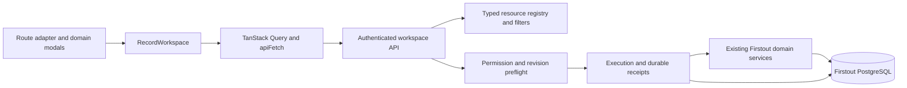

# Focused explorer

> **Updated, 26 November 2026.** More routes now use `RecordWorkspace` than the nine listed below: Catalogue, Bills, Invoices, Payments and Quotes as well, and since 28 November 2026 Stock on hand (`/stock`), fifteen route components in all. The catalogue and Stock on hand use a newer mode with no details pane: the table is full width and opening a row docks the SKU panel instead (`openRecord` in `record-workspace/types.ts`; see [`sku-flow.md`](sku-flow.md)). The rest of this page records the original nine-directory rollout.

Nine Firstout directories use one app-local `RecordWorkspace`: Customers,
Suppliers, Price lists, Locations, Users, Roles, Chart of accounts, Repeating
invoices and Proformas. The approved design keeps the breadcrumb above the
heading, a searchable table on the left, a read-only selected-record card on
the right, and create/edit workflows in Carbon modals. Column customization is
deliberately absent. Dropdown text is left aligned with room for its arrow;
table headings, values and tags use the existing Carbon contrast tokens.

## Component and domain boundaries

`frontend/src/components/record-workspace/` owns layout, typed filter controls,
URL state, sorting, pagination, selection, query feedback and the common bulk
review/results dialog. Small route adapters supply columns, filter definitions,
capabilities and record details. Existing app forms and business-specific
actions stay with their routes. TanStack Query caches server results by actor,
organization, grants and query; changing identity or grants resets route forms
as well as workspace state.

This component stays inside Firstout because it currently depends on Carbon,
Firstout authentication and Firstout contracts. Moving that dependency into
`libs/ui` would expand a legacy design-system dependency across apps. A future
Primer migration should extract shared presentation bricks at that boundary;
this PR does not claim to perform that migration.

The API has a thin router, request/response schemas, a resource registry, typed
filtering, a preflight service and a durable execution service. Domain mutations
reuse existing Firstout services and their validation. Other apps do not access
these tables.

## Filters, selection and mutations

- Search, lifecycle, sort, page size and typed ALL/ANY conditions are represented
  in the URL. Quick filters and advanced filters use the same condition model.
  Applied chips state whether all or any conditions must match.
- The server applies filters and stable sorting across the complete tenant
  result before pagination. The present implementation loads domain lists into
  memory; it does not push predicates into SQL. Larger tenants will need query
  optimization at this service boundary without changing the UI contract.
- Page selection accumulates explicitly. “Select all matching” freezes IDs and
  revisions in a signed 15-minute snapshot, limited to 500 records. New matches
  are excluded; users can exclude individual frozen records. More than 500
  matches requires refining the filter. A changed search, lifecycle, filter,
  identity or grant context clears the selection.
- Bulk edits distinguish leave unchanged, set and clear. Only allowlisted
  fields and actions are accepted. The server previews eligible and blocked
  records with reasons, then rechecks access, current revisions and domain
  constraints during execution. Permanent deletion requires typing `DELETE`.
- An operation applies only its reviewed eligible records, using per-record
  transactions. It is **not an all-or-nothing transaction across a batch**.
  Success/failure receipts commit with each domain mutation. Actor/tenant-scoped
  request IDs allow the same interrupted request to resume or replay without
  reapplying completed changes. Changed payloads cannot reuse an ID.
  Resuming requires the same client request ID and a still-valid 15-minute
  preflight; there is no receipt lookup UI after reload or token expiry. Check
  current status and review again if that retry context has been lost.
- Protected presets, owners, assigned roles, locations with stock or active
  stocktakes, system posting accounts and assigned price lists retain their
  domain restrictions. Ordinary posted accounts may archive while preserving
  posting history. Bulk
  user-role/permission changes and financial-document creation are excluded.

## Lifecycle and preserved workflows

| Screen | Lifecycle | Domain workflows retained |
| --- | --- | --- |
| Customers | Active / Archived | Classification, credit controls, price lists, duplicate checks, portal, invoice/layby/history links |
| Suppliers | Active / Archived | Details, currency, observed lead times and purchasing history |
| Price lists | Active / Archived | SKU price overrides, VAT basis and below-cost warnings; assigned lists cannot be deleted |
| Locations | Active / Archived | Bins and storage management; stock and active-stocktake checks before archive preserve bin/history references |
| Users | Active / Disabled | Invite, role and location assignment; owner disabling remains protected |
| Roles | No artificial archive | Presets are immutable; only unassigned custom roles can be deleted |
| Chart of accounts | Active / Archived | Account balances, system/posting constraints and category posting mappings |
| Repeating invoices | Active / Paused | Customer/line creation, metadata edits and separately confirmed Run now |
| Proformas | Active / Archived | PDF filing, download and the existing document-reading workflow |

Archive preserves references, prices and history. Disabled users and paused
schedules use their existing lifecycle rather than a second archive flag.

## Release preparation and recovery

This is a PR, not production release approval. No provider changes, merge,
deployment or auto-merge are authorized by it.

1. Apply migration `085_record_workspaces` after `084_party_archives` in a
   separately approved release. It adds price-list/proforma archive flags,
   indexes and the tenant-owned batch-receipt table. Existing records remain
   active; domain references remain intact. RLS follows the existing staged
   organization-isolation activation rather than changing that stage.
2. Verify explicit runtime-role DML grants for `record_workspace_batches` and
   current RLS activation in that release. The migration does not infer a
   production login or grant broad access. Local metadata-created fixtures do
   not prove production grants.
3. Supply a durable server-only `RECORD_WORKSPACE_SIGNING_KEY` with at least 32
   characters through managed secrets, identical across API replicas. A legacy
   `JWT_SECRET` of sufficient length is a compatibility fallback. With neither,
   browsing remains available and bulk actions are disabled with an actionable
   message; preflight/execute fail closed. Never use a public placeholder or a
   `NEXT_PUBLIC_` setting. Rotation invalidates outstanding 15-minute snapshots
   and preflights; committed receipts remain in PostgreSQL.
4. Back up before any downgrade after use. Downgrade preserves domain records
   but removes the new archive metadata and batch receipts. Prefer reverting
   application code while retaining this additive schema; obtain explicit
   recovery approval before dropping used receipt/history data.

The batch table has no automatic purge job. Any future retention policy must
preserve the retry/audit requirements before receipts are removed. The 500-row
and 15-minute values are implementation bounds, not platform operational SLOs.

## Verification

The worktree was created from refreshed `origin/main` at `9f3dcb14`, and
`git pull --ff-only origin main` completed before implementation.

Verification uses synthetic records only. The live walkthrough serves a local
production bundle of the actual nine route components, AppShell and AuthProvider
against the actual FastAPI app and a disposable PostgreSQL 16 database. Only
Clerk identity/JWKS and Next routing are local harness adapters. This verifies
the component/API interaction; it does not establish real Clerk or deployed
Next navigation behavior. The normal Next production build is checked
separately. No production personal/customer data is required.

Final check results and walkthrough findings are recorded in the PR. Automated
PostgreSQL coverage includes migration upgrade/downgrade/reupgrade, tenant RLS,
typed filters, permissions, snapshot expiry/limits, stale revisions, concurrent
request replay, archive/reference races and failures after a committed mutation.
Frontend checks cover URL/selection/filter semantics, strict types and the
production build. Keyboard, responsive and contrast checks supplement the
browser walkthrough; a full screen-reader audit remains outstanding.

Observed local results on 15 November 2026:

| Check | Result |
| --- | --- |
| Full Firstout backend regression run | 849 passed; one obsolete protected-table count failed. Count corrected from 82 to 83; complete affected tenant-database suite rerun: 14 passed. |
| Final workspace + price-list HTTP/PostgreSQL suites | 48 passed, including direct deletion protection added during independent review |
| Migration 085 | 2 PostgreSQL tests passed in both author and independent quality runs |
| Backend Ruff lint / formatting | Passed across all 583 Python files |
| Frontend Nx lint / strict typecheck / tests | All three targets passed; 14 workspace regression cases |
| Normal Next production build | Passed, 57 pages generated |
| Clean install / dependency guard / production audit | Passed; audit had no high or critical production findings. Only one Firstout dependency declaration changes in the lockfile. |
| Nx registration / library boundary / diff whitespace | Passed |

The live browser walkthrough visited all nine directories and checked their
breadcrumbs, tables, selected-record cards and available forms. It executed a
25-customer cross-page bulk edit, customer archive/restore, customer creation
and schedule metadata save. It verified zero-result filters, advanced condition
application/reset, search reset after debounce, selection clearing after an
Active/Archived round trip, assigned-price-list deletion blocking, mixed
eligible/protected role previews, owner-disable blocking, category posting and
bin-management entry points, price-list editing and proforma filing forms.
The read-only fixture had no selection/create/edit controls; the Users route
showed a denied state. Keyboard Tab moved through the customer form; dropdowns
retained 44px height, 16px/40px padding and dark text on white at 768px width.
Browser console and inspected API logs had no unexpected errors or HTTP 500s.

No real Clerk login, email/invitation delivery, PDF extraction service, production
grants, deployed navigation or full screen-reader audit was exercised. Existing
domain regression tests supplement the focused UI walkthrough; it is not an
exhaustive manual replay of every retained workflow. Independent frontend,
backend, data, security, quality and delivery reviews reported no remaining
blocking source findings, with corrective slices checked by another reviewer.

## ADR scope

The PR assesses all 66 decisions in the required template. It continues the
existing Firstout Next.js/Carbon/FastAPI stack under P-002's gradual migration
policy; Rust, Actix, Diesel, Primer, generated clients, TanStack Router/Form and
Storybook gaps remain explicit. TanStack Query is introduced for this shared
server state. Conditional C-001/C-002 are not treated as accepted standards.
Independent domain/security/quality review and local evidence do not waive
those gaps or authorize release.
