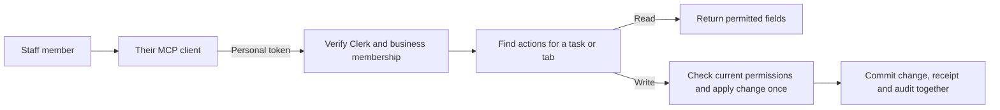

# Firstout MCP domain tools

A staff member can ask an assistant to find an item, check stock at a showroom and move stock on a standalone transfer. Firstout applies the same business permissions it uses for that employee in the app. The employee and the MCP token appear in the audit log.

## How a tool call works

**Getting connected.** Open **Admin → Settings → Integrations → MCP tokens**, generate a token, copy its secret and the displayed server URL into a client that supports a bearer token. Create a separate named token when you want to turn off one connection independently. Firstout attributes requests to the token owner. A token name is a staff label and does not identify the software using it.

**Finding tools.** Call `find_actions` with no arguments for the permitted domains. For example, use `{"query":"draft transfer","tab":"Warehouse"}` to get the exact action name, input schema and effect. Pass the returned `next_offset` to browse more. A tab is a search filter. The client does not need to synchronize its current page with the server.

**Making a change.** Call `run_write` with the discovered action name, validated arguments and a new UUID in `request_id`. Firstout applies authorised changes in the same call, including stock dispatch and receipt. Keep the UUID for retries. A repeated identical call with the same token generation returns the original receipt. Reusing the ID for different inputs fails. To check an uncertain outcome, call `run_read` with action `operations_lookup` and that request ID.

**Moving stock.** Dispatch deducts stock immediately. For receipt, pass the physically counted quantity for every line. A mismatch with dispatched stock needs to be resolved in the warehouse. Firstout checks the transfer state, stock and business permissions before committing the change.

**Undoing a draft.** A draft created by mistake can be cancelled with `transfers_cancel_draft`. No stock moves. Creating a draft and then cancelling it is a safe way to check a connection end to end. The check uses up a transfer number and leaves a cancelled transfer on record. Cancellation through MCP covers standalone drafts only. Firstout refuses a transfer linked to a pick and any transfer that is no longer a draft.

**Upgrading a client.** Refresh the tool list and use `run_write`. The previous `request_write` tool and approval links are retired. Completed operations keep their receipts. Older unconfirmed requests report `not_executed`. Before acting on one of them, check the transfer state and ask the employee whether they still want the change. Use a new request ID for that change.

| Write | Required Firstout permission | Effect |
| --- | --- | --- |
| `quotes_create_draft` | `sales.quotes` | Saves a quote at Firstout's current customer prices. The employee can send or accept it separately. |
| `journals_create_draft` | `books.mutate`, as on the journal creation route | Saves a balanced draft journal. Posting remains a separate action. |
| `transfers_create_draft` | `stock.transfer` | Creates a numbered, standalone transfer. |
| `transfers_dispatch` | `stock.transfer` | Deducts stock at the source and marks the transfer in transit. |
| `transfers_receive` | `stock.transfer` or `till.sell` | Records the counted receipt at the destination. |
| `transfers_cancel_draft` | `stock.transfer` | Cancels a standalone transfer before it is dispatched. Stock stays in place. |

**Operating the service.** `MCP_WRITES_ENABLED=false` pauses MCP writes. Previously completed operations can still be looked up with an authorised active token. The personal token activity screen shows the employee's own history. The audit log lets employees review their own MCP activity and staff managers review activity for their business. A receipt carries the business record number. The audit log can be searched by operation ID, business record ID or record number.

**Delivery boundary.** The implemented writes are the six listed above. Pick-linked transfers, cancelling a transfer that is already in transit, payment capture, posting journals, emailing quotes and access changes continue through their existing Firstout workflows. OAuth-only clients would require a separate authorization-server integration. The external client's model context and caching behaviour remain under that client's control.

The endpoint supports the 2026-07-28 protocol and the existing 2025-11-25 handshake. MCP defines tool listing and calls. Firstout supplies delegated business authorization, audit attribution and write receipts. [MCP versioning](https://modelcontextprotocol.io/specification/versioning) · [MCP tools](https://modelcontextprotocol.io/specification/2026-07-28/server/tools)

## Adding an action

This section is for engineers. A new action needs no new MCP tool. Clients keep finding actions with `find_actions` and running them with `run_read` or `run_write`, and the service grows by adding actions to the catalogue behind those tools. To offer an existing API endpoint as a write, mark it where its router defines it with `mcp_action(...)` from [`mcp_action_types.py`](../backend/app/services/mcp_action_types.py). The cancel route in [`routers/transfers.py`](../backend/app/routers/transfers.py) is the first marked endpoint.

**What you declare.** The action name, sidebar tab, description, the permissions that may use it and the handler that runs it. A mark always declares a write. Use the same Firstout permission keys the route enforces. The mark's permissions are declared separately from the route's own permission check and nothing ties the two together, so every new mark needs a security review.

**What is derived.** The endpoint's required ID parameters, such as `transfer_id`, become the action's inputs. Unknown fields are rejected. An endpoint with a request body, an optional filter or any other kind of parameter needs a hand-written strict arguments class passed as `arguments=`. The mark does not change the HTTP endpoint or the OpenAPI document.

**What fails closed.** The server refuses to start if a mark declares no permission, if the arguments class itself does not forbid unknown fields, if an input cannot be derived and no class is given, or if two actions share a name. The startup check looks only at the top level of a hand-written arguments class. Any model nested inside it must forbid unknown fields too, and that is for the author and reviewer to confirm. A mark also exposes nothing until the router that declares the route is added to the catalogue in [`mcp_actions.py`](../backend/app/services/mcp_actions.py). A parent router that only includes it collects nothing.

**How it runs.** MCP runs the handler, not the endpoint. The handler calls a service `stage_*` method that works inside the MCP transaction. The change, its receipt and the audit entry then commit together.

Marked endpoints join the same catalogue as every other action. `find_actions` still returns only the actions the token owner's current permissions allow, and Firstout authorises every call again.
