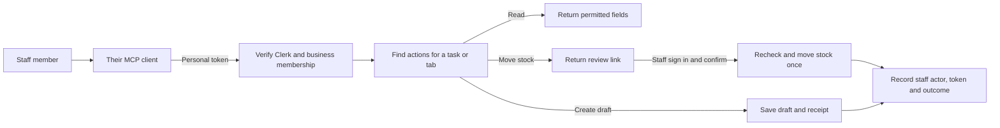

# Firstout MCP domain tools

A staff member can ask an assistant to find an item, check stock at a showroom and draft a transfer. The draft carries their name and a Firstout transfer number. Moving the stock takes a separate confirmation in Firstout.

## Gap analysis against main

The baseline is `9a664e1d`, the merge of Firstout PR #960.

| Area | On main | With this PR |
| --- | --- | --- |
| Connection | Staff could create multiple named tokens in Settings → Integrations → MCP tokens, copy each secret once, and replace, expire or revoke it. | The same personal tokens and server address work with the new tools. Each token belongs to one employee and business. |
| Authority | The server verified the token, live Clerk account and organisation, then checked the local staff membership. Catalogue costs required a separate permission. | Discovery filters actions by the employee's current permissions. Execution checks them again, including the business-specific role. Stock approvals also check the original token generation and current staff access. |
| Discovery | One catalogue search was advertised. | A client sees three general tools plus the original catalogue search. It can browse permitted sidebar domains, then fetch up to three relevant action schemas per page. |
| Reads and writes | The catalogue search was read-only. | Read actions follow the eight sidebar domains. Warehouse can draft, dispatch and receive standalone transfers. Sales can draft quotes. Books can draft journals. |
| Attribution and retries | Token settings showed lifecycle and catalogue activity. | Each successful write has a durable receipt. The audit log distinguishes MCP requests from staff confirmations, with the actor, token reference and operation ID. |
| Protocol | The official SDK already served stateless Streamable HTTP, current discovery and legacy client initialization. | Domain routing uses ordinary MCP tools. Personal-token authorization remains the connection method. |

## How a request works

**Getting connected.** Open **Admin → Settings → Integrations → MCP tokens**, generate a token, copy its secret and the displayed server URL into a client that supports a bearer token. Create a separate named token when you want to turn off one connection independently. Replacing a token also invalidates its outstanding review links. Firstout attributes requests to the token owner. A token name is a staff label and does not identify the software using it.

**Finding tools.** Call `find_actions` with no arguments for the permitted domains. For example, use `{"query":"draft transfer","tab":"Warehouse"}` to get the exact action name, input schema and effect. Pass the returned `next_offset` to browse more. A tab is a search filter. The client does not need to synchronize its current page with the server.

**Saving a draft.** Call `request_write` with the discovered action name, validated arguments and a new UUID in `request_id`. Keep that UUID for retries. A repeated identical request with the same token returns the original receipt. Reusing the ID for different inputs fails. To check an uncertain outcome, call `run_read` with action `operations_lookup` and that request ID.

**Confirming a transfer.** A dispatch or receipt request returns a review link valid for up to ten minutes. The requesting employee signs in to the issuing business, opens the link again if sign-in took them to onboarding, and reviews the source, destination, items, bins and quantities. Receiving requires the physically counted quantities for every line. Opening the link leaves stock untouched. Confirmation rechecks access, the token, the reviewed details and the current transfer state. The action and receipt commit together.

| Write | Required Firstout permission | Effect |
| --- | --- | --- |
| `quotes_create_draft` | `sales.quotes` | Saves a quote at Firstout's current customer prices. The employee can send or accept it separately. |
| `journals_create_draft` | `books.mutate`, as on the journal creation route | Saves a balanced draft journal. Posting remains a separate action. |
| `transfers_create_draft` | `stock.transfer` | Creates a numbered, standalone transfer. |
| `transfers_dispatch` | `stock.transfer` | On confirmation, deducts stock at the source and marks the transfer in transit. |
| `transfers_receive` | `stock.transfer` or `till.sell` | On confirmation, records the counted receipt at the destination. |

**Operating the service.** `MCP_WRITES_ENABLED=false` makes MCP read-only, including outstanding confirmations. Previously completed operations can still be looked up with an authorised active token. The personal token activity screen shows the employee's own history. The audit log lets employees review their own MCP activity and staff managers review activity for their business. A receipt carries the business record number. The audit log can be searched by operation ID or record number.

**Delivery boundary.** The implemented writes are the five listed above. Pick-linked transfers, payment capture, posting journals, emailing quotes and access changes continue through their existing Firstout workflows. OAuth-only clients would require a separate authorization-server integration. The external client's model context and caching behaviour remain under that client's control.

The endpoint supports the current 2026-07-28 protocol and the existing 2025-11-25 handshake. MCP defines tool listing and calls. Firstout supplies delegated business authorization, audit attribution and write receipts. [MCP versioning](https://modelcontextprotocol.io/specification/versioning) · [MCP tools](https://modelcontextprotocol.io/specification/2026-07-28/server/tools)
