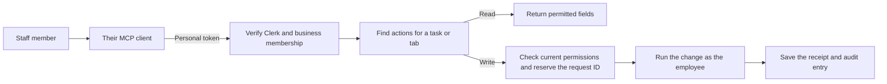

# Firstout MCP domain tools

A staff member can ask an assistant to do the staff work their Firstout permissions allow: look up stock, raise a quote, record a payment, post a journal or move stock on a transfer. Firstout applies the same business permissions it uses for that employee in the app. The employee and the MCP token appear in the audit log.

## How a tool call works

**Getting connected.** Open **Admin → Settings → Integrations → MCP tokens**, generate a token, copy its secret and the displayed server URL into a client that supports a bearer token. Create a separate named token when you want to turn off one connection independently. Firstout attributes requests to the token owner. A token name is a staff label and does not identify the software using it.

**What the assistant can do.** Besides a set of hand-written actions, Firstout offers one action for each staff API route, so an assistant can do what the employee can do in the app. A route action runs the real Firstout route as the token owner. That route's own permission check, validation and business rules apply exactly as they do in the browser. Money and period-close work is included, for example recording payments and till sales, posting and voiding journals, and locking or reopening books and VAT201 periods.

**What stays in the app.** Three groups are left out on purpose. Access and identity: sign-in, users, roles, MCP tokens, organisations, signup, record workspaces and customer-portal access. Files: uploads and downloads such as PDFs, CSV exports, photos, logos and imports, and any action that needs an attached file, such as landing a purchase order. Non-staff surfaces: the customer portal, the ops-commerce feed, storefront orders and refunds, webhooks and health checks. OAuth-only clients would require a separate authorization-server integration. The external client's model context and caching behaviour remain under that client's control.

**Finding tools.** Firstout sends the client short instructions that describe the three steps: find an action, run a read, run a write. The resource `firstout://actions` lists every action the token owner may use right now, one line each under its sidebar tab, with whether it reads or writes. It reflects the owner's current permissions and leaves writes out while MCP writes are paused. Whether a client reads the resource is up to that client. The list carries no input details. Call `find_actions` for those. With no arguments it returns the permitted domains. For example, use `{"query":"draft transfer","tab":"Warehouse"}` to get up to three actions with their exact name, input schema and effect. Pass the returned `next_offset` to browse more. A tab is a search filter. The client does not need to synchronize its current page with the server. Where a hand-written action and a route action do the same job, the hand-written one ranks first on equal relevance and keeps its all-or-nothing receipt.

**Making a change.** Call `run_write` with the discovered action name, validated arguments and a new UUID in `request_id`. Firstout applies authorised changes in the same call, including stock dispatch and receipt. Sending a recorded request ID again with the same inputs and token generation never repeats the change. It returns that change's receipt. Reusing the ID for different inputs fails. To check an uncertain outcome, call `run_read` with action `operations_lookup` and that request ID. After a `failed` or `unknown` outcome, check the receipt and then the record itself, and use a new request ID for any further attempt.

**Reading a receipt.** A receipt's `status` is one of four values.

- `completed`: the change was made. On the first call, a route action's receipt also carries the route's full `response`. A replay or lookup returns the receipt only.
- `failed`: Firstout refused the change and the receipt says why. Fix the cause, check the record, then use a new request ID.
- `unknown`: the change was started but its outcome was not recorded, for example because the route timed out or the server stopped. The change may or may not have happened. Look it up again, since it may still be running. If it stays unknown, the employee should check the record in Firstout before the assistant tries again with a new request ID.
- `not_executed`: an earlier request from before the upgrade below. See **Upgrading a client**.

For a route action a request ID is single-use: once it has been started, the same ID only returns that receipt, even after a failure. Firstout does not keep a route write's request body. It stores a digest of the inputs, to tell a retry from a different change, the record IDs from the route's path, and a narrow receipt: the HTTP status and the response's top-level `id`, `status`, `number`, `*_id` and `*_number` values, never names, contact details or tax and company registration numbers. A hand-written write saves its change, receipt and audit entry together, so it never reports `unknown`.

**Limits.** A result over 128 KB is not returned. Firstout refuses the read and asks the assistant to narrow it with the action's filters or limit, or to use the matching `*_find` action. A write whose response is too large still completes, and its receipt says to read the record instead. A route has 30 seconds to answer. A read that runs out of time fails. A write that runs out of time reports `unknown`. Only a `GET` route is a read. A route that previews or looks something up with `POST`, such as a till price preview, counts as a write and needs a request ID. Rules a route enforces inside the action still apply. For example, only an owner can cancel a transfer that is already in transit. A refusal comes back with the route's own message, and a permission failure reports that the action is unavailable with the employee's current access.

**Moving stock.** Dispatch deducts stock immediately. For receipt, pass the physically counted quantity for every line. A mismatch with dispatched stock needs to be resolved in the warehouse. Firstout checks the transfer state, stock and business permissions before committing the change.

**Undoing a draft.** A draft created by mistake can be cancelled with `transfers_cancel_draft`. No stock moves. Creating a draft and then cancelling it is a safe way to check a connection end to end. The check uses up a transfer number and leaves a cancelled transfer on record. `transfers_cancel_draft` covers standalone drafts only and refuses a transfer linked to a pick and any transfer that is no longer a draft. The route action `cancel_transfer` follows the app's own cancel rules instead.

**Upgrading a client.** Refresh the tool list and use `run_write`. The previous `request_write` tool and approval links are retired. Completed operations keep their receipts. Older unconfirmed requests report `not_executed`. Before acting on one of them, check the transfer state and ask the employee whether they still want the change. Use a new request ID for that change.

| Hand-written write | Required Firstout permission | Effect |
| --- | --- | --- |
| `quotes_create_draft` | `sales.quotes` | Saves a quote at Firstout's current customer prices. The employee can send or accept it separately. |
| `journals_create_draft` | `books.mutate`, as on the journal creation route | Saves a balanced draft journal. Posting is a separate action. |
| `transfers_create_draft` | `stock.transfer` | Creates a numbered, standalone transfer. |
| `transfers_dispatch` | `stock.transfer` | Deducts stock at the source and marks the transfer in transit. |
| `transfers_receive` | `stock.transfer` or `till.sell` | Records the counted receipt at the destination. |
| `transfers_cancel_draft` | `stock.transfer` | Cancels a standalone transfer before it is dispatched. Stock stays in place. |

**Operating the service.** `MCP_WRITES_ENABLED=false` pauses every MCP write, hand-written and route actions alike. Writes then disappear from `find_actions` and `firstout://actions`, and `run_write` refuses them. Reads continue, and previously completed operations can still be looked up with an authorised active token. The personal token activity screen shows the employee's own history. The audit log lets employees review their own MCP activity and staff managers review activity for their business. Each route read is logged with its outcome. A route write logs a neutral "started" entry before the route runs, then exactly one outcome: success, failed, denied or unknown. The Admin audit log shows unknown as "write not confirmed". A write interrupted before Firstout could record its outcome keeps only the "started" entry. Either way the receipt stays `unknown`. An operator finds it as "write not confirmed", or as an entry left at "started", in the Admin audit log, then checks the record itself in Firstout. A receipt carries the business record number when the response has one. The audit log can be searched by operation ID, business record ID or record number. If the service is rolled back to an image older than route actions, that image does not know their names: it reports them as unavailable and refuses to look up their receipts until a newer image is serving again.

The endpoint supports the 2026-07-28 protocol and the existing 2025-11-25 handshake. MCP defines tool listing and calls, and resources that a client application decides how to use. Firstout supplies delegated business authorization, audit attribution and write receipts. [MCP versioning](https://modelcontextprotocol.io/specification/versioning) · [MCP tools](https://modelcontextprotocol.io/specification/2026-07-28/server/tools) · [MCP resources](https://modelcontextprotocol.io/specification/2026-07-28/server/resources)

## Adding an action

This section is for engineers. A new action needs no new MCP tool. Clients keep finding actions with `find_actions` and running them with `run_read` or `run_write`, and the service grows by adding actions to the catalogue behind those tools. There are two ways in.

**Most routes need no MCP code.** At startup [`mcp_routes.py`](../backend/app/services/mcp_routes.py) turns every staff API route into an action, and [`main.py`](../backend/app/main.py) registers them after the last router is included. A new route under an API tag already in `TABS` is offered automatically. Its inputs are the route's path and query parameters plus `body`. MCP refuses an unknown field anywhere in the body, including nested objects, before the route runs, and every published input schema says so. The API's own request models and HTTP behaviour are unchanged. Its permissions are the keys of the route's own permission dependency, so they cannot drift from the HTTP check. An empty set means any active staff member, and the route checks again when it runs. The action is named after the endpoint function, prefixed with the API tag when that name is already used by a hand-written action or another route. Receipts store the name, so renaming an endpoint function renames a persisted action, and earlier receipts under the old name can no longer be looked up. The names are pinned in [`mcp_route_action_names.txt`](../backend/tests/mcp_route_action_names.txt): adding, removing or renaming an offered endpoint fails the catalogue test until that file is updated deliberately.

**What is left out automatically.** A route under a tag in `EXCLUDED_TAGS` or a path in `EXCLUDED_PATHS`, a route without the staff identity dependency, a route taking form fields or files, and a route that returns anything other than a JSON model or an empty 204. A new tag must be added to `TABS`, or to `EXCLUDED_TAGS` with a reason, or [`test_mcp_catalogue.py`](../backend/tests/test_mcp_catalogue.py) fails. Adding a tag to `TABS` offers every route under it, so it needs the same security review as a mark.

**What stops startup.** The app refuses to start if an offered route has a permission dependency with no keys or two permission dependencies, a path parameter that is not a UUID or an integer, header or cookie parameters other than `Authorization`, more than one or an embedded body, a parameter-model query, parameter names that collide, or a name longer than 80 characters, or if two actions share a name.

**A mark for an all-or-nothing write.** Use `mcp_action(...)` from [`mcp_action_types.py`](../backend/app/services/mcp_action_types.py) when a write needs its change, receipt and audit entry to commit together, or MCP-specific limits beyond the route's. Mark the endpoint where its router defines it. The cancel route in [`routers/transfers.py`](../backend/app/routers/transfers.py) is the first marked endpoint. The route itself is still offered as its own route action under a different name.

**What you declare.** The action name, sidebar tab, description, the permissions that may use it and the handler that runs it. A mark always declares a write. Use the same Firstout permission keys the route enforces. The mark's permissions are declared separately from the route's own permission check and nothing ties the two together, so every new mark needs a security review.

**What is derived.** The endpoint's required ID parameters, such as `transfer_id`, become the action's inputs. Unknown fields are rejected. An endpoint with a request body, an optional filter or any other kind of parameter needs a hand-written strict arguments class passed as `arguments=`. The mark does not change the HTTP endpoint or the OpenAPI document.

**What fails closed.** The server refuses to start if a mark declares no permission, if the arguments class itself does not forbid unknown fields, if an input cannot be derived and no class is given, or if two actions share a name. The startup check looks only at the top level of a hand-written arguments class. Any model nested inside it must forbid unknown fields too, and that is for the author and reviewer to confirm. A mark on any route the app serves is collected when the server starts, so there is no list of routers to update in [`mcp_actions.py`](../backend/app/services/mcp_actions.py).

**How it runs.** MCP runs the handler, not the endpoint. The handler calls a service `stage_*` method that works inside the MCP transaction. The change, its receipt and the audit entry then commit together. A route action instead saves a started receipt, runs the route in-process as the token owner through [`mcp_route_runner.py`](../backend/app/services/mcp_route_runner.py), bound to the token's business so a membership resolving to another business is refused, then records the outcome.

Every action joins the same catalogue. `find_actions` and `firstout://actions` return only the actions the token owner's current permissions allow, and Firstout authorises every call again.
